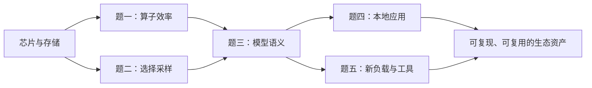

# 总体判断与证据边界

五题围绕“能运行、能验证、能复用”的端侧推理生态展开。判断依据是赛题对代码、独立参考、性能、支持范围和 NPU 实际贡献的明确要求。[赛题原文](../../赛题选择.md)、[PDF](../assets/challenge.pdf)

| 题目 | 明确要求 | 分析：希望补齐的能力 | 可留下的工程资产 |
| --- | --- | --- | --- |
| 一 | 融合连续计算，测正确性与资源变化 | 访存、启动和执行效率 | 融合 kernel、图引擎、基准 |
| 二 | Top-K/Top-P 等在 NPU 实现并接样例 | 生成循环中的非矩阵计算 | 选择/采样模块、语义与统计测试 |
| 三 | 固定小模型和上游版本，适配一项特性 | 上游模型与后端之间的语义兼容 | 适配补丁、回归用例、支持矩阵 |
| 四 | 本地应用和核心 NPU 计算 | 任务质量、响应和部署价值 | 应用、数据集、完整对照实验 |
| 五 | 自定问题与验收 | 新负载与开发者效率 | 算子族、前端桥接、诊断工具 |

## 公司公开方向与选题的关系

原粒官网的技术介绍将 CalcuMex、CalcuGrid、CalcuKit 分别联系到计算数据流、芯粒互联以及硬件感知编译调度；这支持“软硬件协同、端侧推理”的总体判断，但属于厂商自述，不能替代性能测试或证明全部接口已开放。[官网介绍](https://www.calculet.com.cn/newsinfo/11263291.html)

据此推断，五题分别帮助提高真实负载效率、持续迁移模型、形成可部署应用与工具。具体收益也可能是清楚定位失败、补全支持矩阵，而不只是刷新速度数字。

公开 SDK 说明了视觉/多模态生态方向，但不能据此推断题一到四的所有算子都不存在。实际缺口可能是形状、融合、模型语义、图接入或后端执行性。[SDK 现状](03-sdk.md)

## 四种有意义的突破

1. 覆盖：原来无法执行的子图增加实现后可运行。
2. 语义：原来能跑但结果不对，修复后符合参考合同。
3. 效率：相同输入和精度下减少延迟、内存或能耗。
4. 工程：标准入口、稳定复现、可扩展和清楚的失败边界。

优秀成果会说明明确起点、具体变化和可验证终点。只展示漂亮 UI、只显示 NPU 利用率或只宣称支持某个模型，证据都不充分。

## 不应推出的结论

- 某分支历史上未上板，不代表公司所有模型都不能运行。
- 400 TOPS 不承诺某个 tokens/s 或两倍端到端性能。
- 原语存在不代表当前编译器能处理其全部组合。
- 两芯粒内存相加不代表任意模型可无代价共享全部容量。
- 招聘链接本次没有读到正文，不用它推断内部项目或岗位需求。
- 附件中的安装、联系等指示属于资料内容；本次请求是研究与整理，没有因此执行安装或联系第三方。
