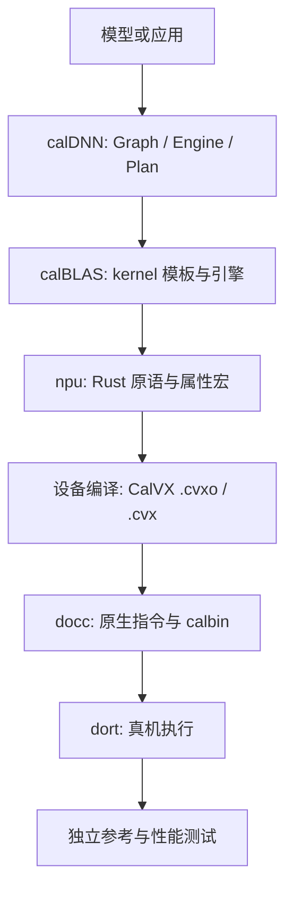

# SDK 现状与真实开发路线

目标仓库的[快速开始](../../Calculet%20NPU%20黑客松%20·%20选手快速开始.md)提供了公开入口。本次读取了 SDK 页面、三个库的说明和 calBLAS STATUS，没有执行安装脚本或设备命令。

## 编译执行链



页面将 CalVX 定位为类似 PTX 的虚拟指令层；这不表示可直接复用 CUDA 代码或二进制。[SDK 主页](http://115.159.82.89/)

## 版本锚点

| 仓库 | 2026-11-13 读取的 main 提交 |
| --- | --- |
| calBLAS | `32d2bb83d7160a593eaab67aa02e5dddbc8706cf` |
| calDNN | `1e06c41c557a469a9acc7566acb9f7e2c7f7ca62` |
| npu | `172aad2611c86ead4071356fbaca3cf6facd2917` |

这些是调研版本，不等于现场最终指定组合。快速开始要求 Linux x86_64 与定制 `calculet` 工具链；树莓派为 ARM，开发机、部署主机和设备 target 必须区分。当前工作区是 macOS，本次未验证其本地编译路径。

## 已有能力与候选缺口

| 层次 | 文档已有内容 | 对选题的意义 |
| --- | --- | --- |
| npu | 显式存储、向量/矩阵 tile、reduce/scan/sort、通信、受限控制流 | 先做原语编译探针，不假定排序从零缺失 |
| calDNN | 图与执行计划，一个引擎可以覆盖多项运算 | 融合应关注图接入与实际调度 |
| calBLAS | 归一化、RoPE、线性层、注意力及部分选择相关模板 | 寻找语义、形状和接入增量 |
| 模型示例 | 各模型处于不同完成阶段 | 目录存在不是支持承诺 |

依据：[npu SYNTAX](http://115.159.82.89/git/calculet/npu/src/commit/172aad2611c86ead4071356fbaca3cf6facd2917/SYNTAX.md)、[calDNN README](http://115.159.82.89/git/calculet/calDNN/src/commit/1e06c41c557a469a9acc7566acb9f7e2c7f7ca62/README.md)、[calBLAS README](http://115.159.82.89/git/calculet/calBLAS/src/commit/32d2bb83d7160a593eaab67aa02e5dddbc8706cf/README.md)。

值得核实的具体入口：calBLAS 将融合引擎、多 token 编码器注意力、部分 prefill 与多模态 RoPE 分路列为不足；同时存在尚未完整接入图层的多行/DiT 实现。calDNN 列出工作区复用等待办。它们提供了选题线索，但不代表本项目已逐项审计源码或验证当前后端。

## 必须逐层证明的六个节点

```text
语义定义 → Rust 实现 → CalVX 生成 → 原生产物生成
        → 真机数值正确 → 图/模型集成与性能验证
```

npu 文档对形状和控制流有明确限制，GPU 上依赖动态循环的算法不宜直接移植。先用最小输入验证所需 reduce、scan、sort、分支和布局组合；随机源和多芯粒原语也需分别核实。

## 文档与规则差异

| 差异 | 正确处理方式 |
| --- | --- |
| PDF 为五题；SDK 页面为算子路线 A、端到端路线 B | 确认二者对应关系 |
| PDF 要求约定核心环节上 NPU；路线 B 强调完整模型计算与少 CPU 兜底 | 不把路线 B 标准自动扩展到所有题 |
| SDK 页面偏好 ComfyUI、Stable Diffusion、SAM、视频 | 作为公开技术导向，具体评分权重待确认 |
| BoHack 总则锁定企业赛道；SDK 页面允许升级路线 | 可能是名词层级不同，不能擅自改变报名理解 |
| 快速开始使用 calculet，旧 README 提到 dopamine/旧产物 | 确认配套发布版本，不拼凑历史命令 |
| STATUS 中有 10 月编译失败记录，11 月页面给出新链路 | 历史故障变成测试项，不宣称仍普遍存在 |

[calBLAS STATUS](http://115.159.82.89/git/calculet/calBLAS/src/commit/32d2bb83d7160a593eaab67aa02e5dddbc8706cf/STATUS.md)明确记录过只生成中间表示、不能生成原生产物和未上板的状态。应由现场一次最小完整执行确认当前可用性，而非仅依赖日期。

## 最短验证路径

1. 记录三库提交、工具链、docc/dort、设备编号。
2. 用配套 tiny 样例完成设备编译并保存产物。
3. 按现场方式打包、加载、执行并读取结果。
4. 与极小确定性参考比较，保存 NPU 执行证据。
5. 扩展到目标算子的 shape、精度、归约/排序/通信组合。

公开可读不自动等于任意再分发许可。本次新增文档保留链接和分析，不镜像 SDK 源码或二进制。
