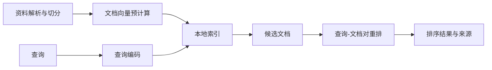

# 题四：本地检索与重排

## 想证明的应用价值

题四要求使用指定公开/合成资料，评价检索或排序效果、全流程耗时，并说明 NPU 核心计算。其价值在于把芯片接入真实的信息处理流程，让评委看见质量、响应和可部署性之间的取舍。[赛题](../../赛题选择.md)

“本地检索”可以不包含回答生成。先找到正确资料、排序并展示出处，已经构成可独立验收的应用；额外接生成模型会增加依赖和延迟，不是这道题原文的必需项。

## 应该把 NPU 放在哪里

| 环节 | 通常可选分工 | 分析理由 |
| --- | --- | --- |
| 文件解析、切分、tokenize | CPU | 字符串和文件处理较多，先保证正确 |
| 文档/查询 encoder | NPU 候选核心 | 神经网络前向计算，需模型和 shape 支持 |
| 索引与 ANN 搜索 | CPU 或已支持后端 | 不能假定图遍历式 ANN 自动适配 NPU |
| 稠密相似度矩阵 | NPU 候选核心 | 规模和批量足够时可能适合，但要计入搬运 |
| Cross-encoder 重排 | NPU 候选核心 | 对候选对做神经网络前向，可批量处理 |
| 排序展示 | CPU | 轻量后处理，保留原始文档位置 |

Sentence Transformers 的官方流程将快速召回与较重的 cross-encoder 重排分开；后者逐对打分，可改善排序，但引入额外计算。[官方检索重排说明](https://sbert.net/examples/sentence_transformer/applications/retrieve_rerank/README.html)

## 最需要提前核实的技术前提

原粒公开文档对编码器多 token 注意力和图支持仍有未完成说明，因此不能把“已有 LLM decode”直接理解为“可运行任意 BERT 类 embedding/reranker”。[SDK 分析](03-sdk.md)

在选模型前核实：双向 attention、padding mask、多 token shape、pooling、位置编码、归一化、权重加载和输出格式。BAAI 的 BGE reranker 可作为任务语义和接口参考，但不是本仓库对其 NPU 兼容性的背书。[BGE 模型卡](https://huggingface.co/BAAI/bge-reranker-v2-m3)

如果官方已经提供可运行的检索/重排基线，应优先沿用它验证全链路。若基线缺失，先完成一个真实查询-文档对的前向探针，再投入 UI 或大量数据整理。

## 推荐的最小作品

一个公开技术文档库：本地加载文档 → 用户输入问题 → 返回 Top-K 段落与来源 → 展示各阶段延迟。数据、模型、切分策略、候选数和测试查询固定；至少一个约定核心阶段实际使用 NPU。

建议采用三组对照，分开回答不同问题：

| 对照 | 固定条件 | 回答的问题 |
| --- | --- | --- |
| 原始召回 vs 加重排 | 相同数据和候选 | 重排是否改善任务质量？ |
| CPU 重排 vs NPU 重排 | 相同模型、输入和精度合同 | NPU 是否改善速度/能耗？ |
| 不同 batch/长度桶 | 相同业务负载与质量要求 | 批处理如何影响吞吐和等待延迟？ |

不能拿 CPU 的弱模型与 NPU 的强模型直接得出纯硬件加速比，也不能把离线文档编码速度当作在线查询速度。

## 评价体系

- **Recall@K**：相关文档是否进入候选；召回不到的文档无法被重排挽救。
- **MRR@K**：首个相关结果排得是否靠前。
- **nDCG@K**：有分级相关性标签时，整体前列排序质量如何。
- **延迟**：首个/全部结果时间、P50/P95、各阶段时间。
- **资源**：索引构建时间、峰值内存、设备搬运、并发与超时。

这些检索指标有成熟官方评估实现可参考。[Sentence Transformers 评估文档](https://sbert.net/docs/package_reference/sentence_transformer/evaluation.html)

使用独立测试查询与人工/已知真值相关性标签；合成查询应说明生成方法，并避免测试问题简单照抄文档标题造成虚高。展示无答案查询、近义词、重复段落和长文截断失败案例。

有价值的工程扩展包括长度分桶、候选批处理、模型常驻、异步流水和清楚的 CPU/NPU 时间线。实施它们之前，先测瓶颈；当索引搜索或 tokenize 占主导时，单独优化重排未必明显改善全流程。
