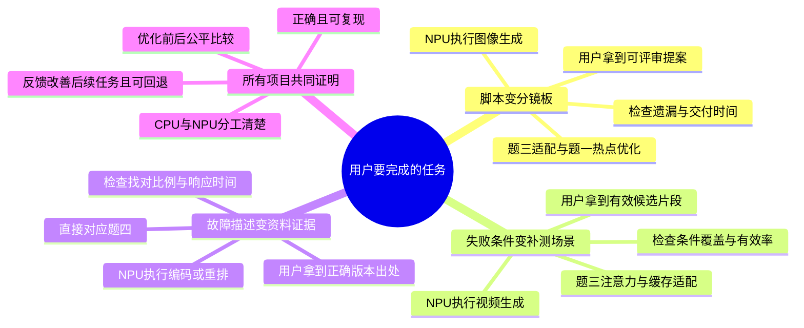

# 从用户任务到 NPU 贡献：三个应用场景与赛题映射

整理日期：2026-11-14（Asia/Shanghai）。本次重新读取了用户提供的两页[赛题 PDF](../assets/challenge.pdf)。下文的赛题要求来自 PDF；应用、商业和技术方案是候选设计，不是已经部署的能力或实测成绩。

## 1. 先用一句话说明我们解决什么

一个合格的项目说明应当能填满这句话：

> 为【具体用户】完成【具体任务】，解决【可观察的问题】；Agent 负责【任务组织】，NPU 执行【核心计算】，通过【具体改动】改善【指标】，以【对照实验】证明。

模型安装、Skills、DeepSeek Harness 是实现这个任务的工具。应用价值要落在最终任务上；用户提供的反馈应当影响后续任务的可检验结果。

五题的共同要求是能运行、能验证、能复用，并说明功能、性能和 NPU 的实际贡献。题一到三主要补底层能力，题四、五主要形成完整任务。它们不是必须同时完成的五个模块。

## 2. 五道题：发现什么问题，采用什么方案

| 赛题 | 发现的问题 | 解决方法与 NPU 工作 | 怎么证明做成了 |
| --- | --- | --- | --- |
| 一：融合算子 | 相邻步骤反复写出、读入中间数据，还可能重复启动与同步 | 把指定连续运算组成融合实现，在条件允许时复用片上数据，并接入调用路径 | 独立参考正确；比较原始 NPU 与融合 NPU 的时间、workspace 和搬运量 |
| 二：选择与采样 | 文本生成中，每次选择下一个 token 都要过滤候选、选择或采样 | 在 NPU 实现约定的 Top-K、Top-P 或相关操作，接入给定样例 | 选择与边界正确；随机操作检验分布；再比算子和完整流程时间 |
| 三：模型特性适配 | 模型所需的位置编码、mask、归一化等，与后端支持不匹配 | 固定上游与小模型，补齐一项明确特性的设备执行路径 | 模型可加载和推理，输出满足参考合同，支持范围和限制清楚 |
| 四：检索与重排 | 面对本地资料，用户难以快速找到相关段落或正确排序 | 将约定的编码、相似度或重排核心阶段放到 NPU，CPU 完成必要文件与索引处理 | 检索/排序质量和端到端耗时；说明处理器分工 |
| 五：开放应用 | 某个具体用户任务，现有部署或使用方式还不能有效完成 | 自定应用与验收，将对任务有实质作用的核心计算接到 NPU | 可运行作品、任务指标、NPU 执行证据、复现材料 |

重要区分：扩散生图中的去噪调度步骤，与题二的 Top-K/Top-P token 采样不是同一个问题。只有真实文本或自回归生成路径需要该操作时，才建立题二关联。

## 3. 三个场景概览

| 候选场景 | 用户真正想拿到的结果 | 与当前项目的关系 |
| --- | --- | --- |
| A：脚本到分镜板 | 一份能用于讨论和修改的视觉提案 | 贴近正在迁移的 H3-Image；完整出图仍需完成 |
| B：仿真场景补测 | 一批围绕失败条件生成、经过筛选的候选片段 | 贴近 Cosmos 方向；完整视频与条件控制仍需验证 |
| C：售后资料助手 | 与设备型号/版本匹配、带原文出处的相关资料和答复 | 对照场景，直接对应题四；需额外可用的编码/重排模型，不是当前必做项 |

以下不假设 NPU 天然更快或更便宜。用户采用本地设备的理由与设备计算优势分开验证。

## 4. 场景 A：广告或游戏团队，把文字脚本变成分镜板

| 项目 | 具体内容 |
| --- | --- |
| 用户 | 广告策划、短片导演、游戏前期美术；尤其是已具备本地设备、有内部创意预演需求的团队 |
| 用户说的话 | “把这段广告脚本拆成六个镜头，每个镜头生成两张概念图，保留说明，整理成一张分镜板。”数字是任务示例，不是性能承诺 |
| 发现的问题 | 用户要在脚本、生成工具、文件夹和排版工具之间反复操作；生成结果还可能遗漏镜头要求，需要人工重做 |
| 输出 | 镜头清单、每镜头候选图、带说明的分镜板、原始文件和可追溯的生成记录 |
| 方案 | 本地文本模型理解脚本并生成镜头计划；Harness 组织任务；NPU 图像模型生成候选图；CPU 整理文件和排版；用户选择及纠错 |
| NPU 核心计算 | 已适配的文本模型前向（若实际接通），图像模型的去噪网络与图像解码等实际支持的阶段。逐阶段记录，不预设全部已经上板 |
| 对应技术问题 | 题三：模型需要的 attention、位置或归一化语义能否正确运行；题一：重复执行的归一化与逐元素步骤是否存在融合机会；正式项目可按题五交付 |
| 具体优化候选 | 先补齐阻塞推理的算子/布局；正确后根据 profile 选择一个重复热点融合，减少中间读写；保持实际允许常驻的组件，避免无意义重复加载，单独报告常驻收益 |
| 用户价值怎么测 | 满足脚本检查项的镜头数量、遗漏数、人工介入/返工次数、完整分镜板用时。图像美感用人工盲评，与可客观检查的指标分开 |
| NPU 价值怎么测 | 同一模型/输入/质量合同下比较 CPU 与 NPU；同一 NPU 下比较原始与优化路径。记录实际执行范围、峰值内存、推理和端到端时间 |
| 商业假设 | 团队可能为减少创意预演时间与整理工作付费。必须访谈并试用验证；现有工作流/API 是现实替代品，单纯加聊天入口价值有限 |
| 反馈学习 | 从用户纠错中提炼“哪些脚本信息容易漏、如何拆镜头”的策略，用下一条未参与学习的脚本检查遗漏是否减少；经验有作用范围、版本和回退 |
| 成立前提 | 完整生成路径、所需内存和交付时长可接受；当前模型未验证的参考图编辑、角色一致性或视频能力不进入承诺 |

一次具体使用过程：用户提交脚本，收到完整分镜板，勾选不合格的镜头并说明原因；系统重新完成任务，并把可复用的漏项检查策略用于下一份脚本。普通脚本可完成的固定整理步骤，保留为确定性工具。

这里对“进化”的验收是后续任务表现，而不是只检查是否新增了一条记忆。第一次自然产生的真实错误可以形成学习输入；不故意制造失败或按演示轮次切换隐藏逻辑。

## 5. 场景 B：仿真测试人员，围绕失败条件补充候选场景

| 项目 | 具体内容 |
| --- | --- |
| 用户 | 自动驾驶或机器人视觉测试工程师；任务先限定到模型实际支持的场景 |
| 用户说的话 | “围绕这次测试失败的条件，整理还缺哪些测试情况，并生成一批支持条件下的候选仿真片段。” |
| 发现的问题 | 测试者需要把失败记录转成可测场景，人工寻找、制作和筛选重复且耗时；某些条件反复漏测 |
| 输出 | 明确的测试条件清单、生成的候选片段、筛选结果和剩余未覆盖项 |
| 方案 | 文本模型提取失败条件并规划补测；用已验证的模型输入表达条件；NPU 执行生成；测试者或独立检查器判断候选是否可用 |
| NPU 核心计算 | Cosmos 视频生成中实际适配的网络前向、注意力和解码阶段；当前方形因果注意力结果不能代替完整 rolling/multiview 推理 |
| 对应技术问题 | 题三：因果/多视角/缓存相关语义与后端差异；题一：验证后再找重复计算与访存热点；正式项目按题五组织 |
| 具体优化候选 | 先实现符合参考语义的注意力与缓存访问；正确后再优化数据复用、布局和搬运；不同阶段分别计时 |
| 用户价值怎么测 | 被独立接受的有效候选数、条件覆盖、筛选与准备耗时。生成的片段需经过验证才能用于测试，不直接宣称真实物理仿真或安全效果 |
| NPU 价值怎么测 | 固定模型、条件、分辨率、长度和精度合同，比较生成阶段时间、峰值内存、搬运与回退；优化前后均检查正确性 |
| 商业假设 | 如果能更快补齐可用测试材料，测试团队可能购买；应以有效场景产出衡量，而非视频数量或画面好看程度 |
| 反馈学习 | 筛掉的原因变成可测试的策略：下次规划相似任务时，主动检查该类遗漏；固定保留任务评价覆盖是否改善，并可恢复旧策略 |
| 成立前提 | 模型能完整生成，支持需要的条件控制，且有独立有效性评价。当前是研发型高风险候选，不把接口和评价能力视为现成 |

示例条件可以来自遮挡、视角或运动关系，但只有模型实际支持的控制方式才进入实现范围。这个场景依赖的资源多于场景 A，不宜在未跑通完整模型时承诺端到端效果。

## 6. 场景 C：售后人员，在本地找到对应版本的维修资料

| 项目 | 具体内容 |
| --- | --- |
| 用户 | 设备售后和技术支持人员 |
| 用户说的话 | “设备型号 A、固件版本 B 出现这个报警，找出相关排查章节，标明来源。” |
| 发现的问题 | 资料分散，型号/版本混淆，关键字结果顺序不理想，人工翻查耗时 |
| 输出 | 相关原文段落、文件位置与型号/版本依据；如生成答复，保持对证据的引用 |
| 方案 | CPU 解析和索引公开/合成资料；NPU 执行已支持的文本编码或相关性重排；本地文本模型基于检索证据组织答复 |
| NPU 核心计算 | 约定的 embedding encoder 或 cross-encoder 重排前向；索引和字符串处理可留在 CPU |
| 对应技术问题 | 直接对应题四；编码器特性不足时涉及题三；只有明确热点才研究题一 |
| 具体优化候选 | 在固定模型与质量下批量重排候选、按长度分组、减少重复加载和搬运；逐项验证，避免批量吞吐提高却让单请求等待变长 |
| 用户价值怎么测 | 找对文档与版本的比例、相关结果排序、带正确出处的答复、用户完成查找的时间 |
| NPU 价值怎么测 | 同一模型与候选集合下比较 CPU/NPU 重排；报告检索质量、重排时间和端到端耗时 |
| 商业假设 | 售后团队可能为减少查找时间和错误版本答复付费；先证明优于其现有文档搜索和手工查找 |
| 反馈学习 | 用户标记错误型号/版本引用，系统形成检索和版本检查策略；在未参与学习的测试查询中验证，不泄漏测试答案 |
| 成立前提 | 有被允许的数据和可用编码/重排模型。它是任务价值清晰的对照方向，不建议为覆盖所有题目追加到当前 H3/Cosmos 项目 |

召回后重排的算法依据见 [Sentence Transformers 官方文档](https://sbert.net/examples/sentence_transformer/applications/retrieve_rerank/README.html)。这个通用方案不证明相应模型已经适配 Calculet。

## 7. 用了 NPU 与优化了 NPU：分别留下证据

| 要证明的事 | 正确对照 | 主要指标 |
| --- | --- | --- |
| 核心计算实际用了 NPU | 实际执行轨迹、作业/模型标识、处理器分工 | 在 NPU 执行的具体阶段、回退范围 |
| 相比 CPU，NPU 对任务有收益 | 同一模型、输入、输出质量和可比精度条件 | 阶段/端到端延迟、吞吐、内存；能耗有读数再报告 |
| 项目改善了 NPU 实现 | 原始 NPU 路径 vs 修改后的 NPU 路径 | 正确性、时间、workspace、搬运；包括退化形状 |
| Agent 改善用户操作 | 原有工具/人工流程 vs Agent 流程 | 人工介入、返工、任务成功与总时间 |
| 反馈学习改善后续行为 | 冻结程序和模型，对比学习前后策略，并测试保留任务 | 重复错误、合格产出、回退后的行为 |

局部 kernel 加速不一定等于用户任务同样加速。不能用 CPU 换成 NPU 的收益，冒充自己对 NPU kernel 的优化收益；也不能把文件整理或缓存收益归因给 NPU 计算。

## 8. 思维导图

## 9. 与当前工作衔接

按现有迁移方向，优先评估 A；B 等完整 Cosmos 能力和评价方式可用后再决定范围；C 保留为对照，不同时开三条实现线。

A 的一个可审查目标可以写为：

> 对一个固定脚本任务，利用本地文本规划和 Calculet NPU 图像生成产出分镜板；明确生成阶段的设备执行与数值/质量验证，测量完整任务用时和人工介入。选择一个真实热点做优化，并比较原始与修改后的 NPU 路径。用户反馈形成可回退策略，在后续脚本上检验遗漏是否减少。

完整 H3-Image 出图尚未验证时，以上是目标。局部算子/后端进展应单独报告，不以预制图片、CPU 生成或回放替代实时 NPU 成果。

## 10. 依据与边界

- [赛题 PDF](../assets/challenge.pdf)：五题要求、独立参考、性能和 NPU 贡献；本次已重新读取两页全文。
- [题一分析](04-track1-fusion.md)、[题二分析](05-track2-sampling.md)、[题三分析](06-track3-adaptation.md)、[题四分析](07-track4-retrieval.md)、[题五分析](08-track5-open.md)：技术解释。
- [Comfy 官方工作流部署说明](https://support.comfy.org/articles/2703236295-comfy-api-deploy-your-comfyui-workflow-as-an-api)：现有生成工作流/API 替代方案，提醒应用必须证明额外任务收益；不表示 Comfy 支持目标 NPU。
- [检索重排官方说明](https://sbert.net/examples/sentence_transformer/applications/retrieve_rerank/README.html)：场景 C 的通用算法依据。
- 用户本轮提供的特别激励规则：自进化作为附加设计目标；最终资格和执行要求以赛事确认口径为准。

本次没有运行模型、修改 SDK、访问共享设备或测量性能。所有收益与商业判断均需通过真实用户任务和对照实验验证。
