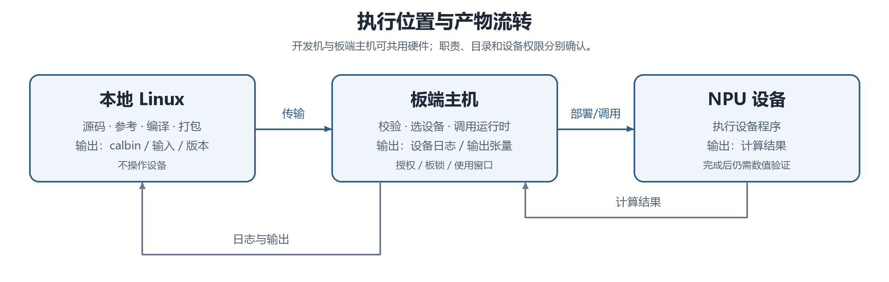
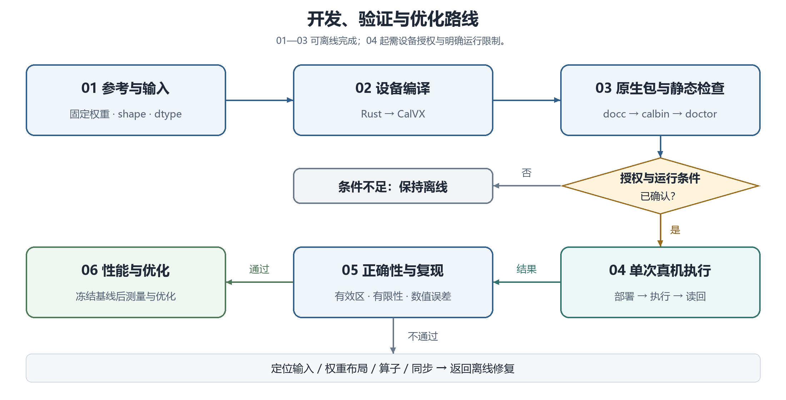

# Calculet NPU 运行手册

> 面向 NVIDIA/CUDA 开发者的任务对照、离线构建与受控上板流程。

| 项目 | 说明 |
| --- | --- |
| 修订日期 | 2026-11-15 |
| 适用范围 | 配套 Linux x86_64 开发环境；以 tiny 说明工具链与运行接口 |
| 已有证据 | 2026-11-14 的 CPU 参考、CalVX、calbin 和 doctor 记录；不包含该组 tiny 的真机数值验收 |
| 本次修订 | 结构与表达重构，不新增 SDK 安装、模型迁移或真机测试结论 |
| 使用原则 | NVIDIA 与 NPU 仅对照任务职责；命令、API、二进制和设备编号不直接兼容 |

**导航：** [迁移对照](#cuda-migration) · [执行路线](#locations) · [环境准备](#prerequisites) · [离线构建](#workspace) · [真机运行](#authorization) · [验收](#outputs) · [归档](#evidence) · [参数](#dort-options) · [排错](#troubleshooting) · [附录](#shell) · [来源](#sources)

<a id="cuda-migration"></a>
## 0. NVIDIA / CUDA 迁移速查

表内命令为职责示意；`...`、`<...>` 和示例文件名不能原样作为完整运行脚本。NVIDIA 侧依据见[官方文档节选](#nvidia-sources)，NPU 侧以所在机器的帮助和配套源码为准。

| 任务 | NVIDIA / CUDA | Calculet NPU | 关键区别 |
| --- | --- | --- | --- |
| 编译器版本 | `nvcc --version` | `rustc +calculet --version --verbose` | 驱动能力、编译器和库版本分别记录 |
| 设备状态 | `nvidia-smi`、`nvidia-smi -L` | 从本机 `dort --help` 查设备查询命令 | 尚未核实固定等价命令；help 不是设备报告 |
| 选择设备 | `CUDA_VISIBLE_DEVICES=2,1 python app.py` | `dort calbin run ... --index <分配下标>` | CUDA 进程逻辑编号不等于 NPU 下标 |
| 开发环境 | CUDA Toolkit、主机编译器 | `rustup`、`calculet`、`docc/dort`、SDK 源码 | 安装 CUDA/PyTorch 不等于安装 NPU 后端 |
| 设备编译 | `nvcc -c kernel.cu -o kernel.o` | `cargo build -p tiny --lib --target dopamine-unknown-none-elf` | 源码与产物不兼容 |
| 中间表示 | `nvcc --ptx kernel.cu -o kernel.ptx` | 构建后检查 `tiny.cvx` | PTX 与 CalVX 不互通 |
| 完整入口 | 主机入口、CUDA 调用与 kernel | tiny 启用 `--features step`；实际模型配置完整程序与主机编排 | kernel 编译不等于完整模型可执行 |
| 原生产物 | `nvcc --cubin kernel.ptx -o kernel.cubin` | `docc calbin from-calvx <目录> --out <新路径>` | calbin 还组织权重、清单与命令流 |
| 算子库 | cuBLAS / cuDNN | 按职责理解 calBLAS / calDNN | 不保证 API、ABI 或算子覆盖相同 |
| 启动计算 | `./app` 或项目的 `python app.py` | `dort calbin run` 与配套主机程序 | `cargo run -p tiny-pack` 是 CPU helper |
| 输入输出 | 应用通过 CUDA Runtime 等接口处理 | LLM 参数、适用的 raw 模式或专用主机程序 | raw 不自动补齐多输入或 LLM 状态 |
| 包结构检查 | 按应用核对文件与依赖 | `docc calbin doctor <包>` | 离线检查，不执行模型 |
| 运行时检查 | `compute-sanitizer --tool memcheck ./app` | 尚未核实直接对应的 NPU 动态检查器 | doctor 不能替代运行时检查 |
| 性能分析 | `nsys profile ./app` | 使用平台确认的测量方法 | `--dump-layout` 不是 profiler |
| 正确性参考 | 项目自己的 CPU/框架参考 | tiny 使用 `tiny-ref`；真实模型另建参考 | 固定相同输入、权重和数值口径 |

| 易混项 | 正确理解 |
| --- | --- |
| `nvidia-smi` 的 CUDA 版本 | 驱动报告的支持能力，不可直接代替 `nvcc` 版本 |
| `CUDA_VISIBLE_DEVICES=2,1` | CUDA 进程内设备 `0` 对应原设备 `2`，不能照搬到 NPU 下标 |
| PTX / CalVX / calbin | 职责可类比，不能通过改后缀或替换命令互相转换 |
| 双芯粒、每芯粒 16 核 / `cores = 2` | SDK 程序核数与硬件计数映射未核实，不机械改为 `16` |
| CUDA 模型迁移 | 保留参考 → 适配算子与布局 → 转换真实权重 → 编译打包 → NPU 数值验证 → 优化 |

<a id="locations"></a>
## 1. 执行位置与路线图





| 当前起点 | 执行范围 | 停止条件 |
| --- | --- | --- |
| 新开发环境 | 第 2～3 节：安装、参考、编译、打包与检查 | 无匹配环境或下载失败 |
| 无真机授权 | 第 3、6 节：离线产物与证据归档 | 不执行部署、推理或设备维护 |
| 已分配设备与窗口 | 第 4～5 节：校验、单次运行、结果比对 | 权限、版本、资源或运行限制未确认 |
| 已有正确性基线 | 第 5 节：复现与性能验收 | 数值或重复性回归 |

<a id="prerequisites"></a>
## 2. 环境准备

**执行位置：团队自己的 Linux 开发环境。共享板端环境由管理员提供，不擅自安装、升级或修改公共配置。**

### 2.1 系统与基础工具

```bash
uname -m
cat /etc/os-release
command -v git curl cc make python3
```

| 检查项 | 要求 / 处理 |
| --- | --- |
| 架构 | 本流程针对 Linux x86_64；其他环境先确认 SDK 支持范围 |
| 基础工具 | `git`、`curl`、主机编译链接工具；`python3` 用于可选分析 |
| 自有 Debian/Ubuntu 容器内 root | 可使用以下 apt 命令；无需额外安装 sudo |
| 自有普通账号 | 仅在已有管理授权时为 apt 命令加 sudo |
| 共享主机或无管理权限 | 由管理员安装依赖，不尝试提权 |

```bash
apt-get update
apt-get install -y ca-certificates curl git build-essential python3
```

<a id="setup"></a>
### 2.2 SDK 源码与安装

已有匹配 SDK 时，核对版本后进入第 3 节。新环境先选择个人或获分配的团队目录；以下示例使用个人家目录。

```bash
SDK_ROOT="$HOME/calculet-work"
mkdir -p "$SDK_ROOT"
git clone http://115.159.82.89/git/calculet/calBLAS.git "$SDK_ROOT/calBLAS"
git clone http://115.159.82.89/git/calculet/calDNN.git "$SDK_ROOT/calDNN"
git clone http://115.159.82.89/git/calculet/npu.git "$SDK_ROOT/npu"
```

```text
calculet-work/
├── calBLAS/    算子实现与示例
├── calDNN/     图与接口
├── npu/        原语与程序声明
└── runs/       独立实验目录
```

**三个仓库保持平级。** 目标目录已存在时先检查来源和未提交工作，不删除或覆盖已有检出。

检查 Rust：

```bash
command -v rustup rustc cargo
ls -ld "$HOME/.cargo/bin" "$HOME/.rustup"
```

默认目录不存在不等于整台机器没有 Rust，还需核对 `CARGO_HOME`、`RUSTUP_HOME` 与管理员提供的安装位置。

**需要安装 rustup 时：下载、审阅、执行分步进行。**

```bash
INSTALL_DIR="$(mktemp -d "$SDK_ROOT/install-XXXXXXXX")"
curl --proto '=https' --tlsv1.2 -fSs https://sh.rustup.rs -o "$INSTALL_DIR/rustup-init.sh"
cat "$INSTALL_DIR/rustup-init.sh"
```

审阅并确认信任来源后：

```bash
sh "$INSTALL_DIR/rustup-init.sh" -y --profile minimal --default-toolchain none
source "$HOME/.cargo/env"
```

下载厂商脚本并审阅：

```bash
curl -fSs http://115.159.82.89/install.sh -o "$INSTALL_DIR/calculet-install.sh"
cat "$INSTALL_DIR/calculet-install.sh"
```

确认与主办方配套版本一致后：

```bash
sh "$INSTALL_DIR/calculet-install.sh"
```

| 安装边界 | 处理规则 |
| --- | --- |
| 下载失败、文件缺失或不完整 | 停止，不执行残缺脚本或错误页面 |
| HTTP 分发 | 审阅脚本不能证明后续二进制可信，使用隔离环境与已确认渠道 |
| HTTPS 证书错误 | 检查时间、证书和代理，不用 `curl -k` 规避 |
| 新终端 | 恢复可信环境与实际 `INSTALL_DIR`，不直接使用丢失的变量 |
| 历史版本 | 记录曾使用 `nightly-2026-11-13`、`calculet`、rustc `1.98.1`；不作为新版本保证 |

### 2.3 工具验收

```bash
rustup toolchain list
rustc +calculet --version --verbose
command -v cargo docc dort
```

选择 `--default-toolchain none` 后，任意目录的默认 `rustc` 可能未配置；使用 `+calculet` 或进入配置了该工具链的工作区。原始安装记录见 [01-setup.md](01-setup.md)。

<a id="workspace"></a>
## 3. 离线构建与产物检查

**执行位置：`calBLAS` 根目录。所有命令按小节顺序执行；新实验使用新目录，避免覆盖基线。**

### 3.1 实验目录

```bash
cd "$SDK_ROOT/calBLAS"
mkdir -p "$SDK_ROOT/runs"
RUN_DIR="$(mktemp -d "$SDK_ROOT/runs/tiny-XXXXXXXX")"
mkdir "$RUN_DIR/weights" "$RUN_DIR/reference" "$RUN_DIR/logs" "$RUN_DIR/outputs"
printf 'SDK_ROOT=%q\nRUN_DIR=%q\n' "$SDK_ROOT" "$RUN_DIR" > "$RUN_DIR/run.env"
printf 'RUN_DIR=%s\n' "$RUN_DIR"
```

| 路径 | 用途 |
| --- | --- |
| `weights/` | tiny 测试权重 |
| `reference/` | CPU 参考 |
| `logs/` | 完整命令输出、帮助和状态 |
| `tiny-native-input/` | 完整 CalVX 与对应权重，下一步创建 |
| `tiny-native-output/` | docc 输出，必须是新路径 |
| `run.env` | 本机路径恢复；只加载团队自己创建且可信的文件 |

<a id="cargo"></a>
### 3.2 权重、参考与完整程序

```bash
cargo run -p tiny-pack --bin tiny-pack -- "$RUN_DIR/weights"
cargo run -p tiny-pack --bin tiny-ref -- "$RUN_DIR/weights" 7 "$RUN_DIR/reference/cpu-out.bin"
cargo build -p tiny --lib --features step --target dopamine-unknown-none-elf
ls -lh target/dopamine-unknown-none-elf/npu/tiny.cvx target/dopamine-unknown-none-elf/npu/tiny.cvxo
```

| 步骤 | 产物 / 验收 | 解释 |
| --- | --- | --- |
| `tiny-pack` | 历史记录为两块参数，各 `6221824` 字节 | CPU 工具生成的测试权重，不是真实模型检查点 |
| `tiny-ref` | token `7` 对应 `cpu-out.bin`；历史大小 `1024` 字节 | `512` 个 bf16 参考值，不是 NPU 输出 |
| `--features step` | 本次生成的完整 `.cvx` / `.cvxo` | 默认 kernel 构建不能代替完整入口 |
| 仅生成 CalVX 的警告 | cargo 尚未生成原生 ELF | 继续由配套 docc 验证原生链路，不将该警告直接解释为 docc 不支持 |

`cargo run` 中单独的 `--` 分隔 cargo 与程序参数；目录、token 和输出路径属于 helper。tiny 本身无主机二进制入口，不能用 `cargo run -p tiny` 代替上板运行。

<a id="docc"></a>
### 3.3 原生生成与打包

先核对本机语法：

```bash
docc calbin from-calvx --help
```

准备输入并生成新包：

```bash
mkdir "$RUN_DIR/tiny-native-input"
cp target/dopamine-unknown-none-elf/npu/tiny.cvx "$RUN_DIR/tiny-native-input/step.cvx"
cp "$RUN_DIR/weights/param_blk0.bin" "$RUN_DIR/weights/param_blk1.bin" "$RUN_DIR/tiny-native-input/"
docc calbin from-calvx "$RUN_DIR/tiny-native-input" --out "$RUN_DIR/tiny-native-output"
ls -lah "$RUN_DIR/tiny-native-output"
```

```text
tiny-native-input/             tiny-native-output/
├── step.cvx                  ├── model_memory_reserved_info.txt
├── param_blk0.bin            ├── param_blk0.bin
└── param_blk1.bin            ├── param_blk1.bin
                             └── tiny-native-input/
```

| 输入约定 | 验收规则 |
| --- | --- |
| `step.cvx` | 刚生成的完整文本程序副本；不将 `.cvxo` 改后缀冒充 |
| `param_blk*.bin` | 与程序声明匹配；`cpu-out.bin` 不属于打包输入 |
| 输出位置 | 使用尚不存在的新路径；历史 `wrote ...` 仅证明工具写出包 |
| 模型名 | 以 doctor 为准，不由输出目录名推断 |

<a id="doctor"></a>
### 3.4 静态检查与已知限制

```bash
docc calbin doctor --help
docc calbin doctor "$RUN_DIR/tiny-native-output"
```

| 检查结果 | 判定 / 后续动作 |
| --- | --- |
| 清单、引用文件、稳态命令流 | doctor 的结构性检查范围 |
| 拒收或解码失败 | 停止上板，先定位包与配套版本 |
| 仅有 warning | 工具可能返回成功；逐项评估，不等于运行安全 |
| 历史 tiny：拒收 0、警告 3、不可解码流 0 | 硬性检查通过，仍有缓冲区复用风险 |
| 历史 tiny：4 个 CCU ELF | docc 确实生成原生产物；不代表设备执行过 |

| 历史同址警告 | ping / pong 的共同地址 |
| --- | --- |
| `in_input_ids` | `0xc05f0000` |
| `in_position_ids` | `0xc0600000` |
| `out_outputs_0` | `0xc0610000` |

**风险：**前后轮次重叠或输出未读取就复用时，数据可能被覆盖。单次候选流程须先确认限制；`--steps 1` 不修复同址，也不证明运行正确。保留警告，不手改清单地址，不直接启用连续、流水或并发。

<a id="authorization"></a>
## 4. 真机部署与运行

### 4.1 执行前置条件

| 门禁 | 必须确认 |
| --- | --- |
| 授权 | 登录入口、团队目录、分配设备下标、使用窗口 |
| 资源 | 当前任务、服务和容器归属；不能凭无锁文件认定空闲 |
| 兼容性 | SDK、运行时、驱动、设备类型、容量与布局匹配 |
| 产物 | 包、权重、输入、参考与版本一致；静态拒收已处理 |
| 风险限制 | 缓冲区生命周期及单次行为已由配套环境负责人确认 |
| 锁协议 | 遵守平台板锁；不删锁、不终止未知任务、不复位设备 |

`--deploy-only` 仍会改变设备状态。`--board-lock external` 仅用于外层已经按约定持锁的情形；等待锁不会延长授权窗口。设备查询命令按本机 `dort --help` 确认，不臆造维护命令。

<a id="transfer"></a>
### 4.2 传输与板端校验

**在开发机：**先按[第 6 节](#evidence)归档并生成清单，再设置获准的 `BOARD_SSH_TARGET`、`BOARD_WORKDIR`。

```bash
scp -r "${RUN_DIR:?先确认本次实验目录}" "${BOARD_SSH_TARGET:?先确认获准的SSH目标}:${BOARD_WORKDIR:?先确认团队目标目录}/"
```

**在板端：**用实际路径替换下列占位值；不加载本地 `run.env` 中的绝对路径。

```bash
RUN_DIR="/主办方分配的团队目录/tiny-本次实验后缀"
(cd "$RUN_DIR" && sha256sum -c MANIFEST.sha256)
docc calbin doctor "$RUN_DIR/tiny-native-output"
```

首次连接核对 SSH 主机指纹，不关闭检查。哈希一致证明传输内容一致，不替代硬件、运行时兼容性或数值验收。

<a id="tiny-run"></a>
### 4.3 tiny 单次运行候选

**执行位置：已授权的板端主机。模板未经本次真机重放；模型名和张量名必须与本次 doctor 报告一致。**

先创建独立的板端运行记录，并将 `NPU_DEVICE_INDEX` 设为实际分配数字，不默认使用 `0`：

```bash
BOARD_RUN_DIR="$(mktemp -d "${RUN_DIR:?先设置板端实际实验路径}/board-run-XXXXXXXX")"
mkdir "$BOARD_RUN_DIR/outputs"
dort calbin run --help
```

```bash
dort calbin run \
  --calbin "${RUN_DIR:?先设置板端实际实验路径}/tiny-native-output" \
  --index "${NPU_DEVICE_INDEX:?先设置获准的设备下标}" \
  --model tiny-native-input \
  --tokens 7 \
  --steps 1 \
  --in-tokens in_input_ids \
  --in-positions in_position_ids \
  --out-logits out_outputs_0 \
  --dump-layout \
  --dump-out "${BOARD_RUN_DIR:?先创建本次板端运行目录}/outputs"
```

| 核对项 | 要求 |
| --- | --- |
| 模型 / 输入 / 输出 | 历史记录使用以上名称，实际以包为准 |
| token `7` | 与 CPU 参考相同；`--steps 1` 是运行器单轮候选，不代表通用 prefill 能力 |
| `--dump-layout` | 核对实际部署 section，排除空部署或落点异常 |
| 输出 | 帮助约定 `<tag>-<步>.bin`，如 `prefill-0.bin`；实际以日志与文件为准 |
| 失败 | 保存完整输出和状态，停止盲目重复运行 |

<a id="raw-mode"></a>
### 4.4 裸字节模式候选

适用于接口已明确的单算子等实验，不代替 LLM 整步状态或多输入编排；以下命令同样需要第 4.1 节授权。

```bash
dort calbin run \
  --calbin "${NPU_CALBIN:?先确认专用包}" \
  --index "${NPU_DEVICE_INDEX:?先设置获准的设备下标}" \
  --model "${NPU_MODEL_NAME:?先核对模型名}" \
  --raw-in "${NPU_RAW_INPUT:?先准备匹配布局的二进制输入}" \
  --in-tensor "${NPU_INPUT_TENSOR:?先核对输入张量名}" \
  --out-tensor "${NPU_OUTPUT_TENSOR:?先核对输出张量名}" \
  --raw-out "${NPU_RAW_OUTPUT:?先选择新的输出文件路径}" \
  --dump-layout
```

| 模式边界 | 处理 |
| --- | --- |
| raw 输入 | 必须已满足 shape、dtype、字节序和布局，不自动解析图片、JSON 或 NumPy |
| LLM 状态 | raw 模式不设置所需的 `cur_seq_len` 等 CSR，不能代替对应 LLM 路径 |
| 多输入模型 | 确认 SDK 绑定方式或专用主机程序，不能靠一个 raw 文件自动补齐 |
| SD3.5 等真实模型 | 仍需真实权重转换、算子适配、阶段调度与参考；tiny 或 `--tokens` 不是通用迁移器 |

<a id="outputs"></a>
## 5. 正确性与性能验收

### 5.1 输出比较顺序

**版本与输入一致 → 提取有效输出 → 核对 dtype / shape → 检查 NaN / Inf → 计算误差 → 检查重复性 → 冻结基线。**

| 项目 | 验收规则 |
| --- | --- |
| 对应关系 | 使用同一次实验的权重、输入、预处理和随机配置 |
| 有效区域 | 明确偏移、长度、padding、调试区和多步组织，不按整个文件长度直接判断 |
| tiny 参考 | 历史 `cpu-out.bin` 为 `512` 个 bf16，即 `1024` 字节；设备张量可能更大 |
| 数值有限性 | NaN / Inf 不能作为通过结果 |
| 误差 | 按语义和验收口径判断；不统一套用“1%”或逐字节相等 |
| argmax | 历史两半词表相同，`303` 与前半 `47` 对应；同分处理不能代替完整比较 |
| 性能 | 正确性和复现通过后，固定输入及计时边界；主机总耗时不是 NPU 核内耗时 |

bf16 解码与指标示例见[折叠附录 B](#bf16-analysis)。CPU 与 NPU 的近似指令可能不同，输出“有数值”或最终 token 相同均不足以完成验收。

<a id="checklist"></a>
### 5.2 结论分级

| 已有证据 | 可以报告 | 不可直接报告 |
| --- | --- | --- |
| 源码构建成功 | CalVX 生成 | 已在设备执行 |
| docc 写出包、doctor 检查到 ELF | 原生产物生成 | 已部署或数值正确 |
| doctor 无拒收、流可解码 | 硬性结构检查通过，列出剩余警告 | 无运行时问题 |
| 实际部署与执行日志、输出文件 | 对应设备上的执行结果 | 完整模型迁移或精度通过 |
| 同输入数值比对与安全复现 | 指定配置的正确性基线 | 任意 shape、模型和精度均支持 |
| 固定基线、明确计时与计算范围 | 对应条件下的性能指标 | 未测量条件的加速或吞吐 |

<a id="evidence"></a>
## 6. 日志与复现实验

### 6.1 版本与帮助

在 `calBLAS` 根目录生成版本文件，并保存本机帮助：

```bash
{
  printf 'calBLAS: '; git rev-parse HEAD
  printf 'calDNN: '; git -C ../calDNN rev-parse HEAD
  printf 'npu: '; git -C ../npu rev-parse HEAD
  rustc +calculet --version --verbose
} > "$RUN_DIR/logs/versions.txt" 2>&1
cat "$RUN_DIR/logs/versions.txt"
docc calbin from-calvx --help > "$RUN_DIR/logs/docc-from-calvx-help.txt" 2>&1
docc calbin doctor --help > "$RUN_DIR/logs/docc-doctor-help.txt" 2>&1
dort calbin run --help > "$RUN_DIR/logs/dort-run-help.txt" 2>&1
```

### 6.2 完整日志与退出状态

以下示例记录整个管道的状态；`tee` 成功不等于前一程序成功。真机日志放在对应的 `BOARD_RUN_DIR`，不用覆盖离线记录。

```bash
set -o pipefail
docc calbin doctor "$RUN_DIR/tiny-native-output" 2>&1 | tee "$RUN_DIR/logs/doctor.log"
status=$?
printf 'pipeline_exit=%s\n' "$status"
```

### 6.3 文件清单与传输复验

归档前确认 `find`、`sort`、`xargs`、`sha256sum` 可用。在文件停止变化后，仅对本次实验生成清单：

```bash
(set -o pipefail; cd "$RUN_DIR" && find . -type f ! -name MANIFEST.sha256 -print0 | LC_ALL=C sort -z | xargs -0 sha256sum > MANIFEST.sha256)
```

```bash
(cd "$RUN_DIR" && sha256sum -c MANIFEST.sha256)
```

| 归档规则 | 要求 |
| --- | --- |
| 实验材料 | 源码/工具版本、完整命令与状态、固定输入、参考、包、警告及输出 |
| 清单范围 | 新增板端输出不自动被旧清单覆盖；按新快照记录，不重写旧基线 |
| 哈希含义 | 内容完整性，不等于来源可信、部署成功或模型正确 |
| 公开发布 | 清除密码、token、私钥和受限服务器信息；脱敏副本单独说明并计算哈希 |
| 大文件与许可 | 权重按权限保存或记录完整哈希，不直接提交到文档仓库 |

<a id="dort-options"></a>
## 7. 参数速查

### 7.1 docc 打包

| 参数 | 用途 / 限制 |
| --- | --- |
| `<DIR>`、`-o / --out` | 输入目录、新输出位置；不是 CPU 参考或单个权重 |
| `--network`、`--arg` | 按配套版本确认值和语法，不从名字臆造 |
| `--ddr`、`--sram`、`--entries` | 地址/预留与入口配置，不按猜测修改 |
| `--max-seq-len` | 历史默认 `32768`；不是已验证上下文长度 |
| `--no-params` | 结构实验不替代真实参数验证；历史 tiny 未使用 |

保留区、地址窗口与包中的数值不等于物理容量或峰值内存占用。CCU 镜像数量也不直接表示物理核利用率。

### 7.2 dort 部署与输入输出

| 参数 | 含义 | 使用约束 |
| --- | --- | --- |
| `-f / --calbin` | 目录或单文件包 | 交付完整包，不只传 `.cvx` |
| `-i / --index` | 设备下标 | 使用分配编号，不默认全部或 `0` |
| `-m / --model` | 包内模型名 | 缺省可能只列模型退出，不等于推理成功 |
| `-j / --json` | JSON 输出 | 先核对实际 stdout/stderr 格式 |
| `--deploy-only` | 只部署 | 仍需授权、资源与锁确认 |
| `--dump-layout` | 实际 section 落点 | 非性能分析器，也非数值验证 |
| `--tokens` | 逗号分隔 token ID | 不是自然语言文本 |
| `-s / --steps` | LLM 输出步数 | 归档帮助中 `1` 仅走 prefill 路径；包语义仍需确认 |
| `-d / --decode-model` | 多步 decode 子模型 | 不猜测名字，不在初次验证开启多步 |
| `--in-tokens / --in-positions` | token / 位置张量名 | 不盲用默认 `inputs[0] / inputs[1]` |
| `--out-logits / --dump-out` | logits 名与每步输出目录 | 使用本次独立目录 |
| `--raw-in / --raw-out` | 裸字节输入/输出文件 | 明确格式，避免覆盖默认公共文件 |
| `--in-tensor / --out-tensor` | raw 张量名 | 不默认叫 `in / out` |
| `--board-lock / --lock-wait` | 板锁与等待秒数 | 不删锁；`external` 仅用于外层按约定持锁 |

<a id="troubleshooting"></a>
## 8. 排错速查

| 阶段 / 现象 | 核对与处理 | 停止条件 |
| --- | --- | --- |
| 找不到 cargo / rustc | 安装位置、用户、PATH、自定义目录；加载可信环境 | 未确认来源时不反复重装 |
| 无默认工具链 | `+calculet` 或进入配置工作区；检查 `--default-toolchain none` | 不用 stable 冒充 NPU 工具链 |
| `cc` 或路径依赖缺失 | 基础工具、仓库平级关系、当前目录 | 不改 kernel 掩盖环境问题 |
| 下载 502、超时或证书错误 | 记录完整错误，核对服务、代理、证书与时间 | 不执行残缺文件，不关闭 TLS 校验 |
| 仅生成 CalVX | 区分 cargo 阶段与 docc 原生生成 | 不报告原生编译或上板成功 |
| `dead_code` | 正常结束且产物存在时无需无关改动 | 不与同址风险警告混同 |
| 缺入口、旧文件或后端拒绝 | feature、更新时间、源码/工具版本和最小输入 | 不猜地址或跳过错误继续上板 |
| doctor 拒收 / 解码失败 | 清单、引用文件、配套版本 | 先修复离线结构 |
| ping/pong 同址 | 生命周期、读取时机、同步与运行限制 | 不手改地址消警告，不启用连续/并发 |
| dort 只列模型 / 找不到张量 | `--model`、实际张量名、调用模式和 dtype | 退出码 0 不代替执行证据 |
| 部署空、输出空 / 0 / NaN / 偏差 | section 落点、输入、布局、权重、状态与同步 | 保留失败记录，不先调容差或做性能优化 |
| 板锁超时或未知占用 | 使用窗口、资源归属与平台协议 | 不删锁、杀进程、停服务或复位 |

问题报告至少包含：阶段、完整命令、stdout/stderr、退出状态、版本、shape/dtype、doctor 报告和设备授权状态。

<a id="concepts"></a>
<a id="shell"></a>
## 附录 A. 工具、文件与 Shell 约定

<details>
<summary>展开：工具与产物定义</summary>

| 名称 | 定义 |
| --- | --- |
| rustup / rustc / cargo | 管理工具链 / 编译器 / 构建与主机工具运行 |
| calculet | 本流程的定制工具链名，不是 CUDA 兼容层 |
| npu / calDNN / calBLAS | 原语与声明 / 图与接口 / 算子实现与示例 |
| docc / dort | 原生生成、包检查 / 设备相关部署与运行 |
| `Cargo.toml` / `rust-toolchain.toml` | 包与依赖 / 当前目录工具链 |
| `.cvxo` / `.cvx` | CalVX 目标文件 / 可读文本程序 |
| calbin / `ccu*.elf` | 部署包 / 包中的原生 CCU 镜像 |
| `param_blk*.bin` / `cpu-out.bin` | 对应程序参数 / CPU 参考，不能混作输入 |
| `git push` / `scp` / `dort ... run` | 发布代码文档 / 传文件 / 部署并执行，三者不同 |

</details>

<details>
<summary>展开：Shell 语法、参数与终端恢复</summary>

| 写法 | 含义 |
| --- | --- |
| `pwd` / `whoami` / `ls -lah` | 当前目录 / 用户 / 文件；不证明设备权限 |
| `/绝对路径`、`.`、`..` | 根路径 / 当前目录 / 父目录 |
| `$HOME`、`"$RUN_DIR/file"` | 当前用户目录 / 将含空格路径作为一个参数 |
| `export X=value` / `X=value` | 向子进程提供变量 / 设置当前 shell 变量 |
| `source 文件` | 在当前 shell 执行可信环境文件 |
| `--` | cargo 参数结束，后续参数交给 helper |
| `-p`、`--bin`、`--lib`、`--features` | 选择包 / 主机二进制 / 库 / feature |
| 行末 `\` | 续行，后面不加空格或注释 |
| `&&` / `;` | 前一命令成功才继续 / 无论成功与否继续 |
| `2>&1`、`tee`、`>` | 合并 stderr / 显示并保存 / 覆盖输出文件 |
| `$?`、`PIPESTATUS` | 上一命令或管道状态；必须立即读取 |
| `${X:?提示}` | 变量为空或未设置时阻止当前命令执行 |

新终端先确认用户、主机与容器，再恢复本次可信路径。以下是占位路径，必须替换：

```bash
source "$HOME/.cargo/env"
source "/实际工作区/runs/tiny-实际后缀/run.env"
cd "$SDK_ROOT/calBLAS"
```

板端目录不同，不加载本地绝对路径配置。提示符 `root@主机:目录#`、表内省略号和占位符不属于可直接复制的命令。

</details>

<a id="bf16-analysis"></a>
## 附录 B. tiny bf16 分析示例

<details>
<summary>展开：仅计算指标，不自动判定合格</summary>

**前提：**CPU 文件恰为 `512` 个小端 bf16；设备对应 logits 从第 `0` 字节开始，且至少包含同样的 `512` 个值。布局不符时先确认提取规则，不能强行截断任意文件。代码未使用真实 NPU 输出进行本次验收。

```bash
python3 -I - "$RUN_DIR/reference/cpu-out.bin" "${NPU_LOGITS_FILE:?先核对实际输出文件与布局}" <<'PY'
import math
from pathlib import Path
import struct
import sys

reference_bytes = Path(sys.argv[1]).read_bytes()
device_bytes = Path(sys.argv[2]).read_bytes()
count = 512
size = count * 2
if len(reference_bytes) != size or len(device_bytes) < size:
    raise SystemExit("文件长度不满足本例前提，先核对输出布局")

def decode_bf16(data):
    words = struct.unpack("<512H", data[:size])
    return [struct.unpack("<f", struct.pack("<I", word << 16))[0] for word in words]

reference = decode_bf16(reference_bytes)
device = decode_bf16(device_bytes)
if not all(math.isfinite(value) for value in reference + device):
    raise SystemExit("出现 NaN 或 Inf，不能当成通过")
errors = [abs(actual - expected) for actual, expected in zip(device, reference)]
maximum = max(errors)
scale = max(max(abs(value) for value in reference), 1e-12)
print("count:", count)
print("max_abs_error:", maximum)
print("mean_abs_error:", sum(errors) / count)
print("max_error_normalized_by_reference_peak:", maximum / scale)
print("仅输出指标；没有自动判定满足模型或赛方容差。")
PY
```

最后一项使用参考峰值归一化，不是逐元素相对误差；bf16 位模式不能按 fp16、f32 或文本直接读取。

</details>

<a id="sources"></a>
## 9. 来源与验证范围

| 材料 | 内容与限制 |
| --- | --- |
| [01-setup.md](01-setup.md) / [02-guide.md](02-guide.md) | 历史 tiny 记录 / 模型迁移方法，不是本次重新实跑 |
| [docc 打包帮助](ref/NPU-guide-20261114/help/docc-calbin-from-calvx.txt#L1-L15) | 终端转录，语法与历史默认值 |
| [doctor 帮助](ref/NPU-guide-20261114/help/docc-calbin-doctor.txt#L1-L7) | 静态检查与失败条件 |
| [dort 运行帮助](ref/NPU-guide-20261114/help/dort-calbin-run.txt#L1-L90) | 包、设备、模型、模式和板锁参数 |
| [完整历史 doctor 报告](ref/NPU-guide-20261114/reports/tiny-doctor.txt#L1-L30) | 4 个 CCU ELF 与全部三条同址警告 |
| [厂商入口取证记录](ref/NPU-guide-20261114/collection-attempts.txt) | 2026-11-14 请求返回 HTTP 502，不表示当前服务状态 |
| [原手册来源说明](ref/NPU-guide-20261114/SOURCES.json) / [哈希清单](ref/NPU-guide-20261114/MANIFEST.sha256) | 历史出处、转录方式与归档字节校验 |

<a id="nvidia-sources"></a>
### 9.1 NVIDIA 对照依据

| 官方文档 | 对照内容 | 原文节选 |
| --- | --- | --- |
| [NVCC](https://docs.nvidia.com/cuda/cuda-compiler-driver-nvcc/index.html) | 版本、PTX 与 cubin | [N1](ref/NVIDIA-comparison-20261114/EXCERPTS.txt#L6-L12) |
| [NVIDIA-SMI](https://docs.nvidia.com/deploy/nvidia-smi/index.html) | 设备查询与驱动能力 | [N2](ref/NVIDIA-comparison-20261114/EXCERPTS.txt#L14-L20) |
| [CUDA 环境变量](https://docs.nvidia.com/cuda/cuda-programming-guide/05-appendices/environment-variables.html) | 可见设备与枚举顺序 | [N3](ref/NVIDIA-comparison-20261114/EXCERPTS.txt#L22-L27) |
| [Compute Sanitizer](https://docs.nvidia.com/compute-sanitizer/ComputeSanitizer/index.html) | 动态检查而非包检查 | [N4](ref/NVIDIA-comparison-20261114/EXCERPTS.txt#L29-L33) |
| [Nsight Systems](https://docs.nvidia.com/nsight-systems/UserGuide/index.html) | 启动应用并进行分析 | [N5](ref/NVIDIA-comparison-20261114/EXCERPTS.txt#L35-L39) |

完整 HTML 指纹和取回方式见 [SOURCES.json](ref/NVIDIA-comparison-20261114/SOURCES.json)，归档校验见 [MANIFEST.sha256](ref/NVIDIA-comparison-20261114/MANIFEST.sha256)。2026-11-14 核对了相关官方文本，未执行表内 CUDA 命令；这些资料不证明另一款 NPU 的接口兼容。

### 9.2 厂商入口与证据约束

[SDK 入口](http://115.159.82.89/) · [npu 语法](http://115.159.82.89/git/calculet/npu/src/branch/main/SYNTAX.md) · [tiny 源码](http://115.159.82.89/git/calculet/calBLAS/src/branch/main/examples/tiny) · [完整程序打包示例](http://115.159.82.89/git/calculet/calBLAS/src/branch/main/examples/minimax_h3/README.md)

帮助转录未独立锁定对应二进制版本，复现须核对本机帮助与配套源码。归档哈希只验证保存文件的字节，不证明原终端字节完全一致、SDK 真伪或模型正确；保留既有证据与历史进度快照，不用新结论覆盖旧记录。
