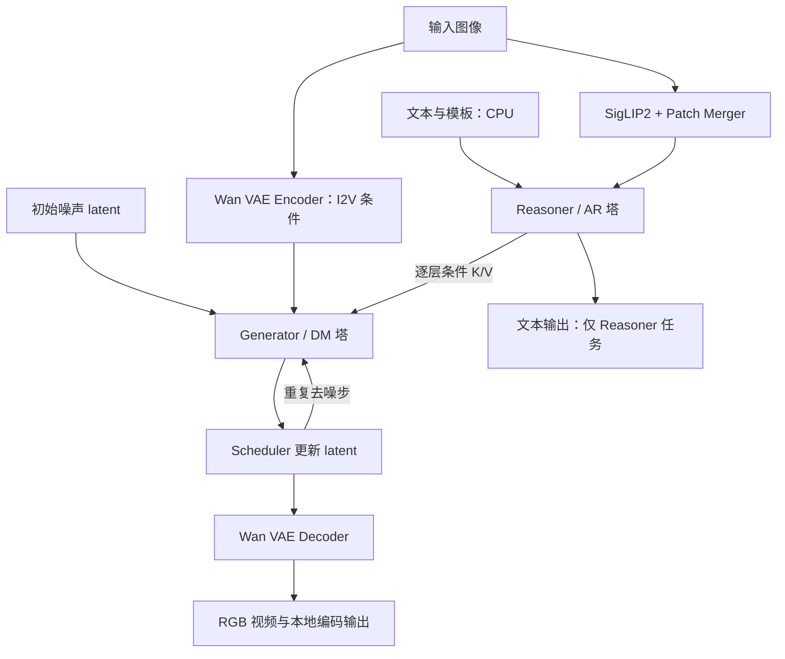

# Cosmos3-Edge 在原粒 Calculet NPU 上的移植调研与参赛方案

调研日期：**2026-11-14，Asia/Shanghai**。目标：原粒 NPU 开发者生态挑战 / BoHack 2026。目标模型：`nvidia/Cosmos3-Edge`。

> 发布说明：本文保留原调研结论与建议；它不代表团队已接受改换目标模型或缩减整模型交付范围。与既有 Nano-Sim-Auto 进度、Dope 路径的关系见 [Cosmos 交接文档](../../HANDOFF.md)。
> 本调研尚未进行 NPU 编译、模型推理或真机测试。发布时仅复算资源估算脚本，未启动 SDK 或设备程序。

**结论先行：值得围绕 Cosmos3-Edge 做参赛项目，但以目前可验证的软件基础，不应把“比赛结束前完整移植视频世界模型”作为唯一交付。建议以真实 Edge FFN 子图的适配和真机验证为主目标，mRoPE 作为有余力时的第二项；长期再推进 Reasoner 和完整 Generator。**

这不是认定硬件跑不了。材料中的 32/64 GB NPU 专用内存，使模型权重容量具有可行性；主要障碍是算子语义、视觉/多行计算、权重排布、执行计划与真机链路。没有真机证据前，不能承诺速度、能耗、完整兼容或实时性。

## 1. 我读取了哪些资料，哪些工作还没有做

读取范围是 本仓库的比赛资料目录 中的赛题、快速开始、BoHack 总则、12 篇调研、阅读入口、来源清单、附件清单和三个模板。重新查看了两张硬件参数图；对其余赛道规则只提取会影响本项目的约束。原有调研是二手整理，本次又直接读取了原粒公开 SDK 首页、三个库的主要说明与状态文档。

同时读取：NVIDIA 模型卡、模型配置和权重索引，Cosmos 3 论文相关架构章节，官方模型支持矩阵，Transformers / Diffusers 的 Edge 与 MoT 实现。保存了官方架构图及可追溯版本。最后又针对 SDK 的 Linear、逐元素、注意力、视觉、编码器、DiT 和部署样例做了源码抽查；不是整个 SDK 的穷尽审计。

本报告使用四类证据：

- **材料事实**：比赛文件和硬件附件写明的内容。
- **上游事实**：公开配置、源码、论文、模型卡能直接支持的内容。
- **工程判断 / 估算**：据上述材料提出的方案，不代表厂商确认。
- **待验证**：需要配套 SDK、参考权重、真机或工程师答复。

**未做事项**：SDK 安装、设备编译、NPU 发射、模型权重整包下载、整模型加载和性能实测。配套 Python 仅计算资源估算，不执行模型。版本与来源见 [evidence_manifest.json](evidence_manifest.json)。第三方缓存未随公开版上传，原始访问入口见 [来源索引](SOURCE_REFERENCES.md)。

## 2. 目标模型核实：是 Edge，不是 Elad

你提到的“Elad”对应的官方轻量型号应为 **Cosmos3-Edge，4B 档**。精确模型 ID 是 [`nvidia/Cosmos3-Edge`](https://huggingface.co/nvidia/Cosmos3-Edge)。本次没有找到名为 Cosmos3-Elad 的官方型号。

| 项目 | 本次核实结果 | 对移植的意义 |
|---|---|---|
| 名称 | Cosmos3-Edge | 不混用 Nano、Super 的权重与配置 |
| 发布 | 模型卡写 2026-07-20；2026-08-25 更新过生成器 | 不能任意拼接旧权重和新运行时 |
| 架构 | 双塔 MoT：AR Reasoner + 连续生成 Generator | 跑通其中一塔不等于跑通全部能力 |
| Edge 主干 | dense；28 层；hidden=2048；FFN=9216 | 不是稀疏 MoE，不要因 MoT 或 `moe_gen` 字段名误判 |
| 注意力 | 16 个 Q 头，8 个 KV 头，head_dim=128 | GQA 分组比为 2 |
| 激活 | ReLU² | 不能沿用 SwiGLU 的第三个 gate 矩阵 |
| 位置 | 3D mRoPE；section=[24,20,20]；theta=1e8 | 普通单路文本 RoPE 不足以覆盖图像/视频 |
| 视觉 | SigLIP2 路径：27 层，hidden=1152；patch=16，2×2 合并 | 需要全注意力、正确 patch 顺序和投影 |
| 生成 latent | 48 通道，空间 2×2 patch，patch维度192 | 不可搬用旧 Cosmos tokenizer 的尺寸 |
| 视频 VAE | AutoencoderKLWan，空间压缩16，时间压缩4 | 单独核查因果 Conv3D、缓存和重采样 |
| 音频 | 当前 Edge 配置 `sound_gen=false` | 不把 Nano/Super 的音频能力移植为首期任务 |

表中参数直接来自 [Reasoner 配置](https://huggingface.co/nvidia/Cosmos3-Edge/blob/main/config.json)、[联合主干配置](https://huggingface.co/nvidia/Cosmos3-Edge/blob/main/transformer/config.json)、[VAE 配置](https://huggingface.co/nvidia/Cosmos3-Edge/blob/main/vae/config.json)。

### 2.1 最重要的范围区别

**A. Reasoner 移植**：图像/视频/文本 → 文本。Transformers 官方文档明确只集成 Reasoner 塔；生成器、VAE 和 scheduler 仍在 Diffusers 一侧。把 `AutoModelForImageTextToText` 跑通，不能称作“视频 WFM 完整移植”。[Transformers 文档](https://github.com/huggingface/transformers/blob/0d7a6219179b24586089ae81b45cf725078e681f/docs/source/en/model_doc/cosmos3_edge.md)

**B. Generator 移植**：文字/图像/动作 → 视频或动作。需要联合主干、生成循环和对应编解码器。它更接近你希望研究的未来预测，但范围大得多。[Diffusers 联合主干](https://github.com/huggingface/diffusers/blob/43e30028af5120d8b0868cb6975b9fad39cc4fab/src/diffusers/models/transformers/transformer_cosmos3.py)

**C. 交互式模拟**：新动作到来后继续生成下一段世界。当前官方 Sim-Auto、Sim-Bimanual、Sim-Transfer 等示例基于 **Nano 16B**；不能把权重名改为 Edge，就当作已经获得同样的因果流式能力。[官方模型参考](https://github.com/NVIDIA/cosmos/blob/540106233a1a834f00fddd368dd6e3e818575696/docs/reference/models.md)

本届若选择 B，建议限定 **I2V、固定输入尺寸、固定帧数、单个模型 revision**。官方矩阵没有为 Edge 承诺全部 Nano/Super 工作流；不要从通用 pipeline 的参数反推特定权重支持范围。

### 2.2 文档存在的差异，应怎样处理

1. 模型卡描述 Reasoner 最长 256K，而本次 `config.json` 的 `max_position_embeddings=131072`。首期只选短上下文，长上下文需要明确扩展配置后单独验证。
2. Edge 文档写视频 50–150 帧，但通用 pipeline 默认189帧，部分性能表也使用189帧。这些值不是本项目可自由混用的统一合同；首期可选53帧（4k+1且在区间内），仍需在固定后端验证。
3. 官方模型参考里有“共享权重”的概括，但论文 §2.3 和当前主干代码明确存在两路独立的投影、norm 和 MLP。**移植时按具体参数图与权重索引处理，不能只按概括文字合并。**
4. 配置中记录的 `transformers_version=4.57.1` 不代表任意安装该版本即可运行当前 Edge 集成；本次官方 Edge 模块位于更新的上游代码中，应固定实际含该类的 commit 或已验证 release。

## 3. 架构图：哪些部分必须移植


图源：[NVIDIA 官方仓库](https://github.com/NVIDIA/cosmos/blob/540106233a1a834f00fddd368dd6e3e818575696/docs/assets/cosmos3-model-architecture.png)。这是系列通用图，包含音频等分支；**Edge 以自己的配置为准**，不能把图中所有分支都当作 Edge 已启用能力。



这是用于移植分工的简化图。具体工作流可能不调用全部入口编码器，必须追踪固定 pipeline 的实际执行；不能为了画图而强制每次执行所有模块。

### 3.1 MoT 不是两个彼此独立的黑盒

在当前联合主干中，每层有两组 Q/K/V/O 投影和两组 MLP。理解流仅做因果注意力；生成流可以读取理解流及生成流的 K/V。源码可检查：

```text
AR:  attention(Q_ar, K_ar, V_ar, causal=True)
GEN: attention(Q_gen, concat(K_ar_for_gen, K_gen),
                          concat(V_ar, V_gen), causal=False)
```

对 Edge，`qk_norm_for_text=false`，但 `use_und_k_norm_for_gen=true`：生成流读取理解流 K 时，仍存在专用归一化路径。遗漏它会改变计算。[主干源码：Cosmos3AttnProcessor / Cosmos3PackedMoTAttention](https://github.com/huggingface/diffusers/blob/43e30028af5120d8b0868cb6975b9fad39cc4fab/src/diffusers/models/transformers/transformer_cosmos3.py)

论文 §2.3 同样区分独立参数与联合注意力；§2.5 指出 Edge 基于从零训练的 dense 2B 语言主干，而 Nano/Super 使用不同的初始化来源。架构知识可迁移，具体权重和配置不能互换。[论文](https://arxiv.org/html/2606.02800v1#S2.SS3)

### 3.2 三条计算语义尤其不能弄错

**FFN：** `y = W_down · ReLU(W_up · x)^2`。是两投影的非门控 FFN。PyTorch 权重布局为 `[out_features,in_features]`，移植时注意转置和 TU 排布。[Edge MLP 源码](https://github.com/huggingface/transformers/blob/0d7a6219179b24586089ae81b45cf725078e681f/src/transformers/models/cosmos3_edge/modeling_cosmos3_edge.py)

**mRoPE：** `[24,20,20]` 的和是 head_dim 的一半64；当前实现按时间/高度/宽度交织选择频率，并使用 half-rotation。不是给128维随意切成三块，也不是把三轴位置都替换成同一个序号。Q头16、K头8需分别覆盖。

**Norm：** FP32 统计与 BF16 转回的顺序、epsilon、weight相乘的位置都影响数值。当前 Transformers 与 Diffusers 的 RMSNorm 实现存在不同的 cast 放置，参考测试须跟随选定入口；“都叫 RMSNorm”不等于逐位等价。

## 4. 目标 NPU 与 SDK：已有基础和实际缺口

### 4.1 硬件核查

| 项目 | 边缘设备材料 | 工作站材料 |
|---|---|---|
| 主机 | Pi 5，Cortex-A76，8GB RAM | MS-A2，9955HX，64GB RAM |
| 加速器 | Calcumex Core | Calcubic R120 |
| NPU 专用内存 | 32GB | 64GB |
| 标称带宽 | 137GB/s | 273GB/s |
| 标称算力 | 200 TOPS | 400 TOPS |
| 功耗 | 典型30W | 最大75W |

来源：[本地硬件调研](../../../../docs/research/02-hardware.md)及原图。以上为标称值，未实测。TOPS 的精度与稀疏口径未明确，不能按 BF16 FLOPs 推视频帧率。

**优先申请工作站做首次验证**：其 x86_64 Linux 开发环境与快速开始一致，主机内存更宽裕。为了减少多芯粒变量，如 SDK 允许，先验证单芯粒；不能由“整卡64GB”推断单颗芯粒可直接访问全部64GB。

Pi 5 的8GB主机内存还可能限制转换、权重解包和 CPU 回退。应在工作站离线打包权重、流式加载至 NPU。Pi 外接链路的实际速率/宽度待确认，附件中的 Gen4×4 是加速器接口描述，不能直接作为 Pi 整机实测速率。

### 4.2 实际工具链

```text
Python：参考、输入准备、权重解析、结果比较
       ↓ 约定二进制文件 / 本地进程接口
Rust 主机：加载、描述计算图、安排内存、执行
       ↓
calDNN Graph / Engine / Plan
       ↓
calBLAS 特化模板 + npu Rust 原语
       ↓ 设备编译
CalVX .cvxo / .cvx
       ↓ docc
原生 calbin
       ↓ dort + 当前配套驱动
NPU 执行 → 输出回读 → 与参考比较
```

官方入口：[SDK 首页](http://115.159.82.89/)。本次读取版本与昨天本地调研记录的三库提交一致：

| 仓库 | commit |
|---|---|
| calBLAS | `32d2bb83d7160a593eaab67aa02e5dddbc8706cf` |
| calDNN | `1e06c41c557a469a9acc7566acb9f7e2c7f7ca62` |
| npu | `172aad2611c86ead4071356fbaca3cf6facd2917` |

工具链应以现场 `calculet` 配套包为准；旧 README 中 dopamine/CWX/ELF 命令有历史遗留，不能与新链路拼装使用。`cargo run` 能打印计划，不等于已经发射。

### 4.3 算子对照

| Edge 需求 | SDK 文档已有候选 | 仍需证明什么 |
|---|---|---|
| BF16 Linear、多行矩阵乘 | `linear!`，含rows、layout和量化格式 | 目标shape、原生编译、权重转换、真机结果 |
| ReLU² FFN | 逐元素原语及 `act!` 片段 | 精确激活、舍入与融合路径；不假定已有完整实现 |
| RMSNorm / LayerNorm | 对应模板 | FP32统计及cast合同与目标一致 |
| 文本 decode | `flash_decode!`、KV相关模板 | prefill、多token及图接入不能由decode推出 |
| 全注意力 / GQA | `attention!` 多行模板 | 视觉分段mask、MoT矩形注意力、静态shape支持 |
| mRoPE | 普通 `rope!` | README明确只读第一路位置，多模态分路仍待补 |
| 视频 VAE | 因果Conv1D；另有Conv2D、GroupNorm、2倍上采样 | 已有2D组件可评估复用；**Conv1D/Conv2D不直接等于Wan因果Conv3D** |
| 图与运行时 | Graph/Engine/Plan | 工作区复用仍列为待办，模板不进图需补注册 |

完整可执行探针清单见 [operator_support.csv](operator_support.csv)。

来源：[calBLAS README](http://115.159.82.89/git/calculet/calBLAS/src/commit/32d2bb83d7160a593eaab67aa02e5dddbc8706cf/README.md)、[calDNN README](http://115.159.82.89/git/calculet/calDNN/src/commit/1e06c41c557a469a9acc7566acb9f7e2c7f7ca62/README.md)、[npu语法](http://115.159.82.89/git/calculet/npu/src/commit/172aad2611c86ead4071356fbaca3cf6facd2917/SYNTAX.md)。

### 4.4 源码抽查对已有调研的重要补充

**不能把 README / STATUS 的旧描述当作当前全部实现。** 同一提交下还存在以下具体代码：

- [`src/kernels/vision.rs`](http://115.159.82.89/git/calculet/calBLAS/src/commit/32d2bb83d7160a593eaab67aa02e5dddbc8706cf/src/kernels/vision.rs)：`conv2d!`、`dwconv3!`、`upsample2!`、NCHW/NHWC转换、`group_norm!`、空间注意力。这里 `dwconv3!` 指3×3的二维depthwise卷积，**不能因名字带3就理解成Conv3D**。这些组件存在于源码，不等于当前全部shape均可用。
- [`src/kernels/encoder.rs`](http://115.159.82.89/git/calculet/calBLAS/src/commit/32d2bb83d7160a593eaab67aa02e5dddbc8706cf/src/kernels/encoder.rs)：有SigLIP/ViT辅助、`vit_gather!`、`vit_mean4!`，并描述头维72→96、FFN4304→4352的对齐。Edge视觉塔恰有这些原始维度，复用潜力比“从零写ViT”更大。但Edge patch是16×16×3=768，不能照搬文档中588维patch的配置；`vit_mean4!`求均值也不能代替Edge的四patch拼接与投影。
- [`src/kernels/attention.rs`](http://115.159.82.89/git/calculet/calBLAS/src/commit/32d2bb83d7160a593eaab67aa02e5dddbc8706cf/src/kernels/attention.rs)：多行`attention!`支持独立key长度、GQA、mask和显式scale，能够作为MoT矩形注意力的候选基础；适配性与真机正确性仍需探针。
- [`examples/yolo26/deploy/DEPLOY.md`](http://115.159.82.89/git/calculet/calBLAS/src/commit/32d2bb83d7160a593eaab67aa02e5dddbc8706cf/examples/yolo26/deploy/DEPLOY.md)：作者记录了2026-10-30在npu2上运行YOLO26n及数值对比。因此不能说“原粒视觉模型都没有上板”。这是**上游作者记录，本次未独立复测**；YOLO网络也不能证明Edge或Wan VAE兼容。文档内约40ms不用于推算Edge速度。
- `examples/d3_turbo/README.md`则仍写明设备编译/verify通过、未出calbin/未上板，说明不同模型阶段不同。

视觉复用时有一条具体陷阱：72维Q/K补零到96以满足对齐后，dot product数学上保持，但注意力缩放应保持 **1/√72**，不是1/√96。现有`attention!`提供独立scale参数，需正确设置；QKV布局、输出投影输入列和padding mask也必须配套。

上述发现降低了“没有视觉基础算子”的风险，但没有消除端到端执行、模型特定语义和3D时序VAE的风险。本报告的完整移植评估已经计入这些已有组件。

### 4.5 为什么 ONNX、CUDA、PyTorch 不能直接解决移植

本次没有查到原粒已提供可直接承载 Edge 的 ONNX Execution Provider、PyTorch设备后端或 Diffusers 后端。因此不能承诺 `export ONNX → 一键导入` 或把 `device="cuda"` 改为 NPU 即可运行。若现场已有新桥接，应让工程师提供一个真实可运行的最小例子再调整方案。

CUDA/Triton/FlashAttention代码可以提供算法与数值参考，其 kernel 和二进制不能直接交给 CalVX 执行。可行方案是复用上游网络语义，把核心子图映射成 Rust/NPU 运算；主机 Python 只做明确披露的组织、预处理或参考工作。

`npu` 形状、行距等主要是编译期常量，kernel不带泛型入口；控制流也有限制。用有限的长度/分辨率桶与padding是现实做法，不能默认动态shape全支持。

## 5. 内存与复杂度：为什么 4B 不等于“2GB就能跑”

### 5.1 权重容量

理想4B参数权重：BF16约8GB、INT8约4GB、INT4约2GB。这只是数学容量，不含额外模块、量化元数据、KV、激活、临时workspace与副本。

本次实际读取的 Generator 联合主干索引记录 `total_size=6,739,314,048` 字节；HF目录还列出视觉编码器约979MB、VAE约1.41GB，整个仓库约9.18GB。目录大小不等于峰值显存，也不等于每个入口都必须加载所有文件。[主干索引](https://huggingface.co/nvidia/Cosmos3-Edge/blob/main/transformer/diffusion_pytorch_model.safetensors.index.json)、[仓库文件](https://huggingface.co/nvidia/Cosmos3-Edge/tree/main)

**建议先用 BF16 建立正确性基线。** 当前 Edge 模型卡只承诺测试 BF16。INT4/INT8 是后续单独工程，不是解决本次移植的自动开关；不能把已有Qwen的W4模板当作Edge已量化兼容。[模型卡](https://huggingface.co/nvidia/Cosmos3-Edge)

### 5.2 Reasoner KV

按batch=1、28层、8个KV头、head_dim128、K/V均为BF16：

```text
KV bytes = 2 × 28 × S × 8 × 128 × 2
```

| 上下文S | KV容量（不含其他数据） |
|---:|---:|
| 2,048 | 224 MiB |
| 8,192 | 896 MiB |
| 32,768 | 3.5 GiB |
| 131,072 | 14 GiB |

所以首期不做最大上下文。图像token、视频帧和padding都要计入实际S。使用更少KV头的其他模型公式会低估此处容量。

### 5.3 视频注意力比权重更容易被忽视

使用本次配置：空间压缩16、时间压缩4、latent空间patch=2。对尺寸可整除、F=4k+1的输入，视觉token数估算为：

```text
T_latent = (F - 1)/4 + 1
N_video  = T_latent × (H/16/2) × (W/16/2)
```

| 调试/目标配置 | 视觉token N | 朴素BF16自注意力分数 Hq×N×N |
|---|---:|---:|
| 320×192，53帧 | 840 | 约21.5 MiB |
| 832×480，53帧 | 5,460 | 约0.89 GiB |
| 832×480，149帧 | 14,820 | 约6.55 GiB |

上表只是**单层单个分数矩阵**的假设容量，未加入AR条件、softmax副本、CFG和其他中间量。分块注意力可以避免完整分配这个矩阵；不应把它乘层数直接当作必需显存，也不应当作实际峰值。另一方面，执行计划如果没有正确复用工作区，可能保留大量不再需要的中间量。

配套脚本 [estimate_resources.py](estimate_resources.py) 已按下载配置运行，结果见 [resource_estimates.json](resource_estimates.json)。FLOPs只估一遍Generator，不包含AR、VAE、CFG等，更不能除以未明确精度的200/400 TOPS当作预测延迟。

## 6. 三种路线的判断

| 路线 | 交付定义 | 风险判断 | 我的建议 |
|---|---|---|---|
| A：Edge算子/子图 | 固定真实Edge形状与权重语义，FFN或mRoPE上NPU，接图并验证 | 最可收敛；依赖原生链路和可用模板 | **比赛首选** |
| B：完整Reasoner | 图像/短视频→文本，视觉encoder、merger和AR全链 | 高；视觉mask和prefill仍有缺口 | 有厂商可跑视觉基线才升级 |
| C：完整Generator | 固定I2V或动作工作流，主干、采样、VAE执行 | 很高；跨越多个未证实环节 | 中长期路线，比赛不单押 |

此表是基于当前证据的工程判断，不是对团队能力的评价。若现场提供完整可运行的某条链路，优先级可以改变。

### 6.1 我推荐的参赛项目表述

> **Cosmos3-Edge FFN 子图的 Calculet NPU 适配与差分验证**：固定上游版本、真实2048→9216→2048形状与ReLU²语义，完成权重排布、NPU执行、图接入和CPU参考对照；测量BF16基线与融合版本的正确性、设备延迟和端到端开销。

先只选这一个主目标。它直接对应Edge的真实计算，保留你对WFM/模型基础设施的兴趣，又能形成可验收增量。单个FFN的两份BF16矩阵约72MiB，相比下载和适配整个模型轻得多。可以先用确定性合成权重验证编译与数学，再用**真实checkpoint层权重**完成模型来源验证；合成版本必须标注为合成，不能称已加载真实Edge。

本次所读文件尚不足以确认是否已有完整且验证过的Edge特化FFN。先向工程师确认；如果已有，不重复包装已有成果。增量转为缺失的多行shape、融合图选择、数值差异修复，或者在允许范围内选择mRoPE。没有测量前不承诺“融合一定更快”。

Linear模板注释还提到激活可在FP32内计算并一次转回BF16；上游ReLU²若在Linear输出后先转BF16再平方，舍入路径可能不同。融合前先约定逐位或容差合同，不能靠改变精度得到一张更快但语义不同的成绩。

它可能对应题一、题三或题五的算子路线，**需以本届选题合同确认**。题三若要求完整模型加载/推理，只有子图不能算完成题三；SDK路线B也明确要求完整模型，不应把CPU跑大部分网络的混合演示包装成路线B。

### 6.2 可作为第二项的 mRoPE

选它的理由：SDK现有RoPE只取第一路位置，Edge实际使用三轴；差异明确，而且可以用很小的输入暴露问题。

第一组用例让 t/h/w 完全相同，验证退化到文本情况；第二组故意不同，防止错误实现蒙混通过；再覆盖位置偏移、较大时间margin、Q16/K8、padding、不同有效长度。对照上游的频率交织和half-rotation，不自行发明简化版本。

可以在CPU预计算cos/sin表，再让NPU应用旋转；必须明确这是主机预计算而非全部位置计算上NPU。性能统计包含必要搬运。mRoPE只有与注意力/位置合同正确接合，才算模型语义增量。

## 7. 完整移植路线：每一步都有继续条件

### P0：固定可执行基线

记录设备、三库commit、工具链、docc/dort及配套示例。按现场已验证步骤完成 `tiny → cvxo → 原生calbin → dort → 回读结果`。快速开始的设备编译命令为：

```bash
cargo build -p tiny --lib --target dopamine-unknown-none-elf
```

命令来自资料，**本次未执行**。打包、加载、等待完成、输出提取应使用现场配套方式，不能猜一套dort参数。若这一步不能取得数值正确的真机结果，先解决平台链路，停止扩展模型规模。

### P1：参考与权重路径

固定模型revision `6afc1256321c3a8e623d89be3bc5117a1e90f96b`，分别固定Transformers/Diffusers。小张量参考可在本机CPU做；完整模型参考优先在有足够内存的本地工作站或获准设备上执行，不依赖远程服务代替参赛实现。

建立 `reference → tensors → kernel outputs → diff`。记录输入、权重和中间张量hash；核对一层MLP的矩阵维度、转置、分片与BF16字节。联合checkpoint含AR和GEN独立参数，注意Transformers入口的重命名/过滤规则，不能因形状相同而用同一份矩阵代替两路。

权重转换先读小段再打包，避免同时保存多份float32巨型副本。目标格式必须符合SDK的TU原生分块布局；用已知矩阵的乘法回读检查，而非只确认文件能打开。

### P2：一个真实FFN或mRoPE在NPU完成

FFN固定D=2048、I=9216，先T=1，再尝试T=16/64/128等约定桶；这些是子图测试形状，不宣称已完成相同长度的整模型。检查非对齐shape的拒绝/填充合同。

除了随机输入，还测零值、负值、零附近、较大有限值及残差抵消。先确认精度，再优化。图引擎须实际选择新实现，设备执行trace能定位到它。

### P3：Reasoner 单层，再28层

把注意力、mRoPE、norm、FFN、残差串成一层。先进行多token因果prefill，再进行重复decode，逐层定位第一个差异。不能拿全注意力代替因果mask，也不能靠缩短上下文掩盖错误。

全层堆叠后先用纯文本检查加载、KV和输出，再接图像。纯文本入口只覆盖Reasoner子能力，最终若承诺视觉必须完成P4。

### P4：视觉encoder和merger

固定单图分辨率，正确展开patch、插值位置embedding并保持2×2合并顺序。SigLIP2处理packed图像/帧时，注意力应保持各图像/帧边界，不能任意互相看见。merger还涉及LayerNorm及GELU的具体版本，SDK的tanh-GELU不一定等价于所有上游GELU。

每过一层保存参考，最后才验证图片问答。常量图、不同颜色位置块及多图输入是有用的顺序/边界检查。

### P5：联合MoT一层与完整去噪主干

独立实现AR/GEN投影、专用K归一化、3D位置、因果/全注意力和两路FFN。关键验证：改变GEN噪声不应改变同一层AR输出；改变AR条件应该能影响GEN输出。

先比较单个固定timestep，再比较28层和一次完整主干前向。保持latent、KV和workspace驻留设备，避免每个小算子回CPU。稳定条件下可缓存AR每层K/V，但CFG正/负条件要分开；不能直接跨去噪步缓存不断变化的GEN中间结果。

### P6：scheduler与VAE

固定UniPC/native-flow设置、时间尺度、噪声、seed、步数及CFG。当前pipeline签名默认35步、guidance=6；它是通用实现默认值，不是最佳配置承诺。开启CFG时一轮可能包含条件和无条件两次主干执行，不能把一次forward计时当整段生成。[pipeline源码](https://github.com/huggingface/diffusers/blob/43e30028af5120d8b0868cb6975b9fad39cc4fab/src/diffusers/pipelines/cosmos/pipeline_cosmos3_omni.py)

Wan VAE需要因果Conv3D、空间/时间重采样、norm、残差、patch处理与分块历史。首先做单个decoder块，再比较连续两块与整段解码的一致性。若把Conv3D按时间切片改写为Conv2D与求和，必须保持因果padding、历史缓存、步幅、通道次序及偏置，仅作为候选降低方法，不能默认更快。

可先让scheduler、文件编解码留在CPU；VAE或主干如果还回CPU，要披露其占比并按比赛合同命名成果。CPU解码产生MP4不等于VAE网络也跑在CPU；二者需分开记录。

### P7：端到端与优化

先选固定RGB输入、256p、53帧，完成同模型同参数质量对照；再扩480p、更长帧数或新的动作任务。超出Edge已声明范围的输入，只能列实验性探针，不当作官方支持。

优化次序：工作区活跃区间复用 → 减少layout/PCIe往返 → 多行矩阵乘和分块注意力 → AR条件缓存 → 量化 → 多芯粒。每项修改分开测，避免量化和算法同时改变导致无法归因。完整静态shape变体需记录编译成本和缓存。

ComfyUI节点适合作为后续前端：它调用本地host服务、后者提交NPU计划。节点显示视频不是执行证据；现场先打通数值闭环，再投入UI。

## 8. 比赛时间内怎样安排，怎样收缩范围

本地总则写 **11月15日08:00提交**，5台设备共用，硬件作品另交不超过3分钟视频；是否有更新以现场为准。不要假设现在仍有完整24小时开发窗口。

按剩余有效时间倒排，以下是检查点，不是保证工期：

| 时间预算 | 行动 | 继续/收缩条件 |
|---|---|---|
| 首30–60分钟 | 工程师确认tiny真机、可改接口、FFN/多行支持和验收口径 | 没有可运行基线，优先只补单算子，不开整模型 |
| 约1–3小时 | 合成小输入→真实Edge维度FFN；独立参考与读回 | 原生代码或数值失败，就聚焦最小失败点 |
| 后续可用时段 | 真实层权重、图接入、融合/未融合对照 | 只有编译无执行，不能标记真机完成 |
| 最后至少25%–33%时间 | 重复测试、保存原始结果、清洁复现、报告/视频 | 冻结范围，停止临时增加视觉/视频目标 |

假如你们已经有成熟图像模型在该SDK上运行、并得到工程师协助，可以重新评估完整Reasoner甚至I2V。但那需要新的基线证据；本次资料尚未提供。

## 9. 正确性、性能、质量如何验收

### 9.1 三层正确性

1. **算子层**：与选定上游/独立参考比较最大绝对误差、相对误差分布和失败坐标；零附近另设绝对误差。容差由dtype和主办方合同确定，不事后为了通过而放宽。
2. **子图/模型层**：逐层比较，确定性logits/latent，定位第一个差异；本征的采样发散不能用一句“随机性”解释掉。
3. **任务层**：固定图像/短视频/动作样本，检查生成与控制关系、物体一致性、输出质量。图像看起来相似不能替代算子数值测试。

对生成路径比较每步latent、最终解码输出和任务质量；量化实验另列精度合同。相同seed只有在随机源、顺序和数值路径也固定时才足以复现。

### 9.2 五种时间必须分开

编译、加载/传输、预热、同步完成的设备执行、同业务入口的端到端时间。记录重复次数、P50/P95、形状、缓存、其他队伍干扰。异步提交返回耗时不能冒充kernel耗时。

报告CPU/NPU分工、回退、主机/设备峰值内存与传输字节。数算子数量占比不能当作加速贡献。若只优化原系统10%的部分，即使该部分无限快，其他条件不变时总加速上限也仅约1.11倍。

没有功耗传感器或墙插实测，就填写“未测”；30/75W标称值不能直接转成实测每视频能耗。单/双芯粒比较优先在同主机完成，否则只能称整机对比。

### 9.3 最小交付清单

- 固定版本、输入/权重hash、CPU参考和运行入口。
- 支持的shape/dtype/layout，以及明确拒绝的范围。
- 新实现被图采用和NPU真实执行的日志/trace。
- 基线/修改版的原始CSV、误差、延迟及计时边界。
- 本队新增贡献、已有模板、未完成与失败案例。
- 一页结果与可重复演示；若只做子图，标题、PPT和代码保持同一范围。

可继续使用原仓库 [实验报告模板](../../../../templates/experiment-report.md)和[结果表](../../../../templates/benchmark-results.csv)。

## 10. 最应立即向现场工程师确认的八件事

1. 哪个tiny或Linear案例**今天可生成原生calbin并跑出正确结果**？配套工具版本是什么？
2. `linear!(rows=...)`、BF16、FP32统计与目标shape是否已上板？ReLU²是否已实现、能否注册为融合图引擎？
3. mRoPE的三路位置、half-rotation和当前prefill支持有什么已验证边界？
4. 申请工作站时，是否可固定一颗芯粒运行？32/64GB如何寻址和划分？
5. 现场有没有已实现且可复用的Conv2D/Conv3D、ViT或视频VAE样例？仅有代码模板还不够。
6. Python到Rust主机的推荐调用/二进制输入输出协议、权重打包工具、等待完成和profiler接口分别是什么？
7. 只有Edge真实子图适配时，应按题一、题五路线A还是其他合同验收？题三是否必须整模型？哪些CPU步骤允许保留？
8. 哪些代码和日志允许随作品公开？设备排队时段、最终复测、提交时间有无新通知？

这些是报告提出的问题，本次没有联系或向第三方发送消息。公开SDK可读，不自动解决再分发许可；报告只引用必要公开信息。

## 11. 我的最终判断

**长期：这个方向适合继续做。** Edge具有相对清楚的dense结构，主干有公开实现，真实WFM负载能推动多行注意力、mRoPE、视频解码、静态shape与异构调度等基础设施工作。你可以从模型问题进入硬件约束，而不是只做展示。

**本届：完整视频移植风险过高，单点真实闭环更值得争取。** 当前资料还没有证明原生执行、视觉encoder、MoT、VAE各层均可运行；这些缺口同时存在时，工程范围远大于“换设备接口”。不要把研究计划写成实现成绩。

如果最终只完成一个真实Edge FFN子图，却给出正确性、图集成、真机执行和清楚的性能证据，仍是具体的工程贡献。若继续到Reasoner或Generator，就逐级升级成果名称。项目路线可以雄心很大，交付边界必须精确。

## 12. 论文、仓库、架构和版本索引

| 来源 | 链接 / 本次用途 |
|---|---|
| Cosmos 3 论文 | [arXiv:2606.02800](https://arxiv.org/abs/2606.02800)，§2.3、§2.5与Appendix D；[官方论文 PDF](https://research.nvidia.com/labs/cosmos-lab/cosmos3/technical-report.pdf) |
| 系列官方仓库 | [NVIDIA/cosmos](https://github.com/NVIDIA/cosmos)；commit `540106233a1a834f00fddd368dd6e3e818575696` |
| 官方架构图 | [固定commit原图](https://github.com/NVIDIA/cosmos/blob/540106233a1a834f00fddd368dd6e3e818575696/docs/assets/cosmos3-model-architecture.png) |
| Edge模型 | [模型卡](https://huggingface.co/nvidia/Cosmos3-Edge)；revision `6afc1256321c3a8e623d89be3bc5117a1e90f96b` |
| Edge参数与主干 | [config](https://huggingface.co/nvidia/Cosmos3-Edge/blob/6afc1256321c3a8e623d89be3bc5117a1e90f96b/config.json)、[transformer/config](https://huggingface.co/nvidia/Cosmos3-Edge/blob/6afc1256321c3a8e623d89be3bc5117a1e90f96b/transformer/config.json) |
| 官方工作流矩阵 | [models.md](https://github.com/NVIDIA/cosmos/blob/540106233a1a834f00fddd368dd6e3e818575696/docs/reference/models.md) |
| 官方部署/训练配方 | [Cookbook](https://github.com/NVIDIA/cosmos/blob/540106233a1a834f00fddd368dd6e3e818575696/COOKBOOK.md) |
| Transformers | commit `0d7a6219179b24586089ae81b45cf725078e681f`；[Edge模块](https://github.com/huggingface/transformers/tree/0d7a6219179b24586089ae81b45cf725078e681f/src/transformers/models/cosmos3_edge) |
| Diffusers | commit `43e30028af5120d8b0868cb6975b9fad39cc4fab`；[联合Transformer](https://github.com/huggingface/diffusers/blob/43e30028af5120d8b0868cb6975b9fad39cc4fab/src/diffusers/models/transformers/transformer_cosmos3.py)、[pipeline](https://github.com/huggingface/diffusers/blob/43e30028af5120d8b0868cb6975b9fad39cc4fab/src/diffusers/pipelines/cosmos/pipeline_cosmos3_omni.py)、[Wan VAE](https://github.com/huggingface/diffusers/blob/43e30028af5120d8b0868cb6975b9fad39cc4fab/src/diffusers/models/autoencoders/autoencoder_kl_wan.py) |
| 最新交互模拟 | [arXiv:2611.06627](https://arxiv.org/abs/2611.06627)，[项目主页](https://research.nvidia.com/labs/cosmos-lab/cosmos-simulation/)；区分Nano示例与Edge基座 |
| 原粒公开SDK | [首页](http://115.159.82.89/)，固定三库commit见§4；具体执行接口以配套发行版为准 |
| 比赛约束 | [赛题](../../../../%E8%B5%9B%E9%A2%98%E9%80%89%E6%8B%A9.md)、[现有SDK研究](../../../../docs/research/03-sdk.md)、[验收方法](../../../../docs/research/10-evaluation.md) |

原先猜测的 Diffusers `pipelines/cosmos3/pipeline_cosmos3.py` 路径不存在，后来已在官方目录找到上表的正确路径。单独的 `Cosmos3-Edge-Reasoner` 仓库本次也未取得，Reasoner入口应以官方统一Edge checkpoint与Transformers支持为准。
