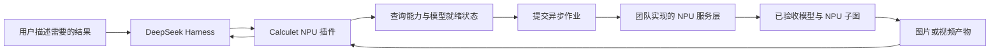

# NPU 后端接入草案：calculet.npu/v1

这是本项目插件提出的 HTTP 合同，**不是原粒官方 SDK API，也不代表设备已提供这些端点**。模型迁移团队可在已验收推理入口外增加薄服务层；Harness 插件负责发现能力、提交作业和取回状态。



## 配置

| 字段 | 默认值 | 用途 |
| --- | --- | --- |
| `backendURL` | 空 | 团队实际提供的 HTTP(S) 服务根地址；支持路径前缀 |
| `apiToken` | 空 | 可选 Bearer Token，宿主 secret 字段 |
| `timeoutMs` | 15000 | 单次 HTTP 请求的超时，不是整个生成任务限时 |
| `maxResponseBytes` | 1048576 | JSON 响应大小上限 |
| `maxPromptChars` | 8000 | 提交提示词长度上限 |

所有响应使用 `application/json`。不跟随 HTTP 重定向。失败使用非 2xx HTTP 状态；插件不会把后端任意错误正文当作工具指令。账号令牌只发往配置的服务，产物 URL 必须与该服务同源。

## 1. GET /v1/capabilities

下面是**格式示例**；当前插件默认没有后端，真实可用模型列表为空。

```json
{
  "protocolVersion": "calculet.npu/v1",
  "backendId": "team-npu-service",
  "executionKind": "not_run",
  "models": [
    {
      "id": "team-image-model",
      "displayName": "团队仍在测试的图像模型",
      "tasks": ["text-to-image"],
      "readiness": "testing"
    }
  ]
}
```

`readiness` 为 `ready`、`testing` 或 `unavailable`。只有 `ready` 且支持相应任务时才能提交；`executionKind: not_run` 时拒绝生成。不要仅因模型下载完成或单个算子通过就把整模型标成 `ready`。

`executionKind` 为 `hardware`、`simulation` 或 `not_run`。这是后端声明，插件不能独立证明设备执行；竞赛仍需真实 trace、版本、核心子图与 CPU 回退证据。

## 2. POST /v1/jobs

```json
{
  "modelId": "team-image-model",
  "task": "text-to-image",
  "prompt": "用户确认的生成要求",
  "seed": 42
}
```

`task` 枚举为 `text-to-image`、`text-to-video`、`image-to-video`。后端按模型能力开放子集。`seed` 可选，为无符号 32 位整数。图生视频必须另外提供 `inputArtifactId`；它指向已由后端取得的图片，本版本不传递用户本机任意文件路径。

服务应尽快返回异步任务，避免 HTTP 连接一直等到生成结束。插件不自动重试提交，避免请求结果不确定时重复生成；正式服务应补充幂等键设计。

```json
{
  "id": "job-001",
  "status": "queued",
  "modelId": "team-image-model",
  "task": "text-to-image",
  "executionKind": "not_run",
  "artifacts": []
}
```

## 3. GET /v1/jobs/{jobId}

返回同一任务结构。状态枚举为 `queued`、`running`、`succeeded`、`failed`、`cancelled`。失败必须提供 `error: {code, message}`。成功必须带产物，且执行模式不能为 `not_run`。

产物结构为 `{id, uri, mimeType}`；相对 URI 按服务根地址解析。作业和产物 ID 仅允许 1–128 个 ASCII 字母、数字、点、横线和下划线，首位必须是字母或数字。产物路径由服务控制；插件当前返回引用，不下载图片、不验证文件内容，也没有自定义图片/视频 UI。

## 插件侧的等待与展示

新增 `npu_wait_job({jobId, maxWaitMs?, pollIntervalMs?})`，仅反复调用上述 GET 接口，不需要后端新增等待端点。
默认等待 30 秒、间隔 1 秒；等待上限允许 1–60000 ms，间隔允许 10–10000 ms。
返回 `{jobId, completed, timedOut, elapsedMs, job?, queryError?}`。

- `completed=true` 表示到达 `succeeded`、`failed` 或 `cancelled`，不能单凭这个布尔值判断生成成功。
- 等待预算包含 HTTP 请求耗时。到时返回最后快照和原 ID；没有读到快照时 `job` 缺省。
- 查询失败返回错误与最后快照，允许稍后用原 ID 恢复；不会自动重复 POST。
- 调用方中断会停止当前轮询，不取消后台作业。作业取消接口尚未实现。
- 在同一次等待期间检查模型、任务类型和执行模式的一致性；允许排队时 `not_run` 变成实际执行模式。

生成和查询的展示文本包含状态、执行模式、错误、产物链接，以及支持的栅格图片 Markdown 引用。
独立本机联调台可实际预览和下载测试图片；它不是官方 Harness 聊天 UI 插件。
正式产物鉴权与浏览器可达性仍需和模型服务联调，不能假定 Bearer Token 会自动附在浏览器图片请求中。

## 交接验收

模型团队提供一项已验收能力、真实服务地址和一份示例任务后，依次验证：能力发现 → 提交 → 轮询 → 产物可读取 → 与原生入口结果一致。再补设备/模型/SDK 版本、NPU 核心计算、CPU 回退、编译/加载/预热/推理计时。不要将本机协议测试当作该步骤完成。

后续需要商定而尚未实现：输入上传、作业取消、幂等提交、产物生命周期与鉴权、结构化执行证据、能力参数（分辨率、帧数等）、用户反馈与回退。最终接口按已跑通模型设计，避免提前声明不支持的能力。
